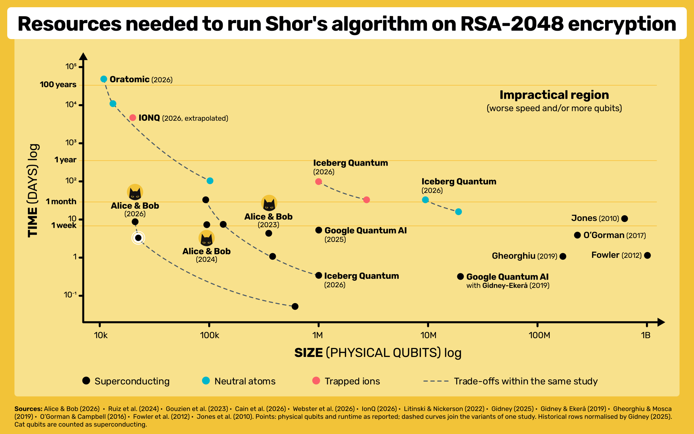

## The shrinking resource frontier is not a hardware milestone

A 128-page preprint published in October 2026 proposes a striking resource estimate for one of the most consequential benchmarks in quantum computing: factoring a 2,048-bit RSA modulus. Axel Pappalardo and colleagues calculate that a particular superconducting cat-qubit architecture could complete the task with **22,593 physical cat qubits** and an **expected elapsed quantum runtime of 3.14 days**. The result is not a laboratory factorization of RSA-2048. It is a carefully specified, architecture-dependent prediction, conditional on a fault model and on physical operations that have not yet been demonstrated together in a processor of the stipulated scale.[^what-22593-cat-qubits-really-mean-primary]

**Why should this matter to anyone who does not work in quantum computing?** Because much of the digital world's security depends on mathematical problems that ordinary computers cannot solve within a practical amount of time. When a browser establishes a secure connection to a website, when a banking application authenticates its server, when an employee connects to a corporate network through a VPN, or when a smartphone verifies that a software update comes from its legitimate publisher, cryptographic mechanisms help establish confidentiality, authenticity, and integrity. Those mechanisms underpin the trust relationships on which everyday digital services depend.

Consider the familiar padlock associated with an HTTPS website. HTTPS uses TLS, the successor to the now-obsolete SSL protocols, to establish an encrypted and authenticated connection between the browser and the server. In contemporary TLS deployments, asymmetric cryptography typically performs two distinct functions: a digital signature helps authenticate the server, while an ephemeral key exchange establishes secrets from which the symmetric encryption keys are derived. The actual traffic is then protected by symmetric encryption, such as AES or ChaCha20. The security of the public-key mechanisms commonly used for authentication and key establishment—including RSA, elliptic-curve signatures, and elliptic-curve Diffie–Hellman—rests on mathematical problems that a sufficiently powerful quantum computer running Shor's algorithm could solve efficiently.

The consequences extend well beyond web browsing. Quantum attacks against these public-key mechanisms could eventually affect the authentication of online banking services, confidential VPN communications, secure email and messaging protocols, digitally signed contracts, software distribution, firmware updates, and the authorization of cryptocurrency transactions. The precise vulnerability depends on which cryptographic algorithms each system uses: Shor's algorithm does not directly break AES or every component of TLS, nor does it imply that all encrypted communications would become readable immediately. It threatens the mathematical foundations of specific public-key mechanisms that often establish or authenticate the security of those systems.

| Activity                          | What public-key cryptography helps protect            | Potential future quantum impact                                                  |
| --------------------------------- | ----------------------------------------------------- | -------------------------------------------------------------------------------- |
| HTTPS websites and online banking | Server identity and secure key establishment          | Impersonation or decryption of recorded sessions under vulnerable configurations |
| Corporate VPN and remote access   | Authentication and encrypted communications           | Recovery of vulnerable key-agreement secrets or identity impersonation           |
| Software and smartphone updates   | Authenticity of signed software                       | Forged updates if signing keys become recoverable                                |
| Digitally signed documents        | Authenticity, integrity, and verification             | Forged signatures and challenges to long-term evidentiary trust                  |
| Cryptocurrencies                  | Transaction authorization using public-key signatures | Unauthorized spending where vulnerable public keys are exposed                   |

: Everyday digital activities and their potential exposure to quantum attacks against public-key cryptography. {#tbl-what-22593-cat-qubits-really-mean-everyday-quantum-impact}

The temporal dimension makes the problem more consequential than an ordinary future technology risk. An adversary can record certain encrypted communications today and attempt to decrypt them years later, once quantum capabilities become available. Information that must remain confidential for decades can therefore be captured and retained today, even though its contents may become accessible to an adversary only after the necessary quantum capabilities emerge. Signature-based authentication creates a related but different problem: keys and trust anchors used to authorize software, transactions, or documents may remain valid long after the mathematical assumptions supporting them have become insecure. These risks concern not only future communications, but also **information and trust relationships created today whose required security lifetime extends into the quantum era**.

This is why reducing the estimated resources required to execute Shor's algorithm matters, even without an operational quantum computer capable of breaking RSA-2048. A resource estimate does not provide a date for cryptographic compromise, but it changes our understanding of the engineering requirements that separate the mathematical attack from its physical realization.

The numerical improvement is substantial. Gidney and Ekerå's influential 2019/2021 surface-code estimate involved approximately 20 million noisy qubits and eight hours. Gidney's 2025 refinement brought the estimate below one million qubits, with a runtime measured in days. The new cat-qubit estimate reduces the physical footprint by nearly fortyfold relative to Gidney's 2025 detailed calculation of 897,864 qubits, although the assumed physical error channels, encoded operations, and architectures are different. The figures must not be interpreted as results of a controlled comparison in which every variable except the qubit technology has been held constant.[^what-22593-cat-qubits-really-mean-historical]

Alice & Bob illustrates this historical movement in the resource-frontier graphic accompanying its blog post, referenced below as an SVG asset. The image is useful for displaying the joint dependence on qubit count and runtime; its coordinates are *published estimates*, not observations of hardware actually factoring RSA-2048.

{#fig-what-22593-cat-qubits-really-mean-resource-frontier fig-cap="The shifting modeled space–time frontier for RSA-2048. Source: Alice & Bob's 29 October 2026 companion blog; estimates are conditional on different physical and architectural assumptions." width="100%"}

The intellectual question is consequently more precise than whether quantum computers have suddenly become forty times easier to build. Which improvements arise from mathematics and logical compilation; which arise from exploiting a physical noise asymmetry; and which require hardware capabilities that have not yet been achieved? A complete interpretation also requires distinguishing a nominal qubit footprint from the full processor and its supporting infrastructure. Replacing one error-correction architecture with another changes not just data storage but gates, resource-state production, routing, decoding, and the ways failures accumulate.

The paper reports three cryptanalytic workloads. Its main result is the physically mapped RSA-2048 configuration. It also estimates roughly 29,588 cat qubits and about 61.8 minutes for elliptic-curve discrete logarithms on secp256k1, and approximately 6,656 cat qubits and 21.2 minutes for a deliberately smaller 512-bit finite-field discrete-logarithm benchmark. These estimates do not have identical levels of compilation completeness: the latter workloads reuse the RSA physical primitives and employ less exhaustive resource derivations. The paper additionally explores space-efficient and parallel variants, as well as a roughly 45,000-qubit alternative that would correct some physical bit flips at the cost of further modeled overhead.[^what-22593-cat-qubits-really-mean-primary]

The claim worth defending is therefore substantial but bounded. The authors have moved the **modeled architecture frontier** for fault-tolerant quantum cryptanalysis; they have not demonstrated that a cryptographically relevant quantum processor exists. Nevertheless, the distinction between mathematical possibility and physical realization should not obscure the cybersecurity implications: the public-key cryptography on which everyday digital trust depends is vulnerable to a known class of quantum algorithms, and successive improvements in their implementation are reducing the estimated resources needed to exploit that vulnerability. This is the foundation for both the technical appraisal of the paper and its broader implications for industrial strategy, digital sovereignty, and the transition to post-quantum cryptography.

## Alice & Bob: from European quantum research to industrial sovereignty

Alice & Bob was founded in France in 2020 by **Théau Peronnin**, its chief executive, and **Raphaël Lescanne**, its chief technology officer. The scientific origin of the company lies in research on bosonic cat states and engineered stabilization of superconducting oscillators. Lescanne's work, developed through the French quantum-research ecosystem, demonstrated why carefully designed dissipation could produce a physical qubit with a strongly asymmetric error channel; Peronnin and Lescanne then sought to industrialize that approach. The company's stated ambition is to construct a universal, fault-tolerant quantum computer rather than rely exclusively on noisy intermediate-scale computation.[^what-22593-cat-qubits-really-mean-alice-bob-company]

The commercial organization has grown beyond its French founding laboratory. By October 2026, the company reported more than 250 employees, four offices, and more than €180 million in cumulative financing. Its January 2025 **€100 million Series B** was led by Future French Champions, AVP, and Bpifrance, with participation from existing investors including Elaia Partners, Breega, and Supernova Invest, as well as public investment mechanisms associated with the European Innovation Council and the French state. Future French Champions is a partnership involving Bpifrance and the Qatar Investment Authority, a useful reminder that the location of investment management and the ultimate source of investment capital are not necessarily identical. In May 2026, Alice & Bob announced an undisclosed additional investment by **NVentures**, NVIDIA's venture-capital arm. Participation in financing establishes economic exposure but does not, by itself, establish voting control, rights over research, or ownership of the company's technology.[^what-22593-cat-qubits-really-mean-alice-bob-investors]

The financial commitments are accompanied by investments in industrial capacity. Alice & Bob announced plans for a research and production facility of approximately 4,000 square metres in Paris, financed in part through its Series B. This is significant because the transition from laboratory demonstrations to fault-tolerant processors requires much more than a theoretically favorable qubit design: specialized fabrication, device packaging, cryogenics, quantum-control electronics, classical processing, error-correction software, and sustained calibration capabilities must eventually operate as an integrated system.

In October 2026, Alice & Bob reported that its GPU-based LDPC-cat decoding proof of concept used NVIDIA NVQLink and Quantum Machines' OPX1000 control infrastructure. The experiment employed synthetic syndrome data and did not demonstrate real-time decoding, but it illustrates the hybrid quantum–classical architecture required by its approach. Such partnerships can accelerate development by exploiting specialized industrial capabilities; they also introduce dependencies whose strategic significance cannot be determined solely from the company's French headquarters.[^what-22593-cat-qubits-really-mean-alice-bob-gpu]

### PROQCIMA: five competing technological approaches

The French **PROQCIMA** programme places Alice & Bob within a substantially broader national effort to develop industrially viable, universal quantum computers. Launched in March 2024 by the Direction générale de l'armement (DGA), with support from France 2030 and the French government's investment apparatus, PROQCIMA adopts a staged competitive procurement mechanism rather than selecting a single favored quantum-computing technology at the outset.

On 5 March 2024, the DGA awarded framework agreements to five French companies: **Alice & Bob, C12, Pasqal, Quandela, and Quobly**. Their selection is particularly important because the companies pursue substantially different physical implementations of quantum information processing, each with its own scaling advantages and engineering constraints.[^what-22593-cat-qubits-really-mean-proqcima-programme]

| Company | Physical quantum-computing approach | Principal engineering proposition |
|---|---|---|
| Alice & Bob | Superconducting bosonic cat qubits | Exploit strongly biased physical noise to reduce the overhead of quantum error correction |
| C12 | Electron-spin qubits in carbon nanotubes | Exploit carbon-based nanostructures and electron-spin control for quantum processing |
| Pasqal | Laser-controlled neutral atoms | Exploit atomic arrays, reconfigurable geometry, and collective optical control |
| Quandela | Photonic quantum computing | Encode and process quantum information in photons using optical components and photonic circuits |
| Quobly | Electron-spin qubits in silicon semiconductors | Exploit silicon microelectronic fabrication techniques and semiconductor integration |

: The five initial participants in France's PROQCIMA programme and their distinct hardware approaches. The table describes their technological strategies, not experimentally normalized performance or comparative maturity. {#tbl-what-22593-cat-qubits-really-mean-proqcima-platforms}

The diversity of these approaches is not incidental. Superconducting cat qubits promise reduced error-correction overhead through engineered noise asymmetry but require stabilized oscillator operation and demanding microwave and cryogenic infrastructure. Neutral atoms offer flexible spatial arrangements, but their control, gate dynamics, and correction-cycle durations differ from superconducting devices. Photonic computing has distinct opportunities for optical communication and integration, together with challenges in resource generation, loss management, and fault-tolerant processing. Electron-spin systems in carbon nanotubes or silicon seek advantages from nanoscale devices and semiconductor fabrication, while confronting their own constraints in qubit uniformity, control, coupling, and readout.

These are differences in underlying engineering assumptions rather than merely competing implementations of an otherwise identical processor. It is therefore impossible to establish which technology offers the most favorable route to a universal fault-tolerant computer simply by comparing announced physical-qubit counts. PROQCIMA's architecture-neutral selection strategy is consistent with this uncertainty: public funding supports several technological hypotheses until experimental evidence and industrial feasibility justify progressively narrowing the field.

The programme was initially announced with a maximum aggregate framework value of **€500 million**, covering a multi-year process of technological proof of concept, maturation, and eventual industrialization. Its competitive structure envisages an initial assessment period from 2024 to 2026, a further competition through 2028 that should reduce the field from five candidates to three, and a subsequent maturation period culminating in the selection of at most two technologies by 2032. The objective is not simply to reward the most convincing theoretical design, but to identify approaches capable of sustaining increasingly integrated demonstrations and eventually being manufactured and operated at scale.

The technical ambition was materially revised in **May 2026**. Under the French government's accelerated quantum strategy, the target for 2032 increased from **128 logical qubits to approximately 1,000 logical qubits**, specified as **1,024** in a subsequent Ministry of Armed Forces communication. The government also announced a doubling of PROQCIMA funding for the 2026–2030 period, with **€300 million allocated over four years**. These announcements describe the revised programme's financing and objectives; they should not be interpreted as €300 million already disbursed, nor simply added to the original €500 million framework ceiling without reconciling the relevant budgetary and contractual scopes.[^what-22593-cat-qubits-really-mean-proqcima-revision]

A target of 1,024 logical qubits represents an ambitious industrial milestone, but it is not equivalent to demonstrating the RSA-2048 machine described by Pappalardo and colleagues. The preprint's factoring workload requires 1,433 abstract logical qubits in its selected algorithmic configuration, while its physical architecture includes extensive storage, routing, resource-state production, decoding, and correction infrastructure. More fundamentally, a logical-qubit count does not establish the gate fidelity, effective logical error rate, computational depth, factory throughput, or bit-flip suppression required for a particular cryptanalytic workload. The existence of a programme target therefore supplies evidence of institutional ambition and planned investment, not experimental validation of the resource estimate.

Alice & Bob's October 2026 Phase 1 disclosures are best understood within this distinction. The company reported three independently operated demonstrators, consisting of two six-qubit chips and one twelve-qubit chip. The reported work included noise-biased CNOT gates, ancilla measurement and reset, repeated distance-three repetition-code cycles, logical-error measurements, and a physical non-Clifford gate. The company also stated that the measured logical-error performance was **not yet below the relevant error-correction threshold**. These results constitute meaningful evidence of component integration and progress toward the programme's early technical milestones, but not a demonstration of scalable fault-tolerant computation.[^what-22593-cat-qubits-really-mean-proqcima]

### From national hardware development to a sovereign computing stack

The French institutional strategy is not confined to physical quantum processors. In September 2026, the Ministry of Armed Forces announced **ALIQUANTE**, a complementary five-year project intended to develop sovereign quantum-programming capabilities in preparation for the systems emerging from PROQCIMA. Led by the French defense innovation authorities, it was entrusted to a consortium comprising Thales Research & Technology, BULL SAS, and the Commissariat à l'énergie atomique (CEA).

ALIQUANTE is intended to provide tools for programming different QPU technologies, compiling quantum circuits, emulating quantum processors, estimating computational resources, and allocating execution between high-performance classical computing systems and quantum processors. Its intended applications include defense workloads and the processing of classified information.[^what-22593-cat-qubits-really-mean-aliquante]

This institutional development is directly relevant to interpreting the Alice & Bob RSA-2048 paper. A quantum processor's strategic utility depends not only on the existence of physical qubits, but also on the ability to formulate algorithms, compile logical operations into physical instructions, manage classical–quantum coordination, and evaluate the resources required for useful computations. The cryptanalytic contribution of Pappalardo and colleagues demonstrates the importance of these capabilities: architectural choices concerning arithmetic, error-correcting codes, resource factories, and scheduling can materially change the modeled hardware requirements even when the underlying mathematical problem remains unchanged.

The distinction between hardware development and software sovereignty is consequently more than organizational. A state or industrial ecosystem possessing quantum processors but depending entirely on external compilers, firmware, cloud orchestration, calibration software, or classical decoding infrastructure may lack independent control over the resulting computing capability. Conversely, domestic expertise in algorithms and compilation can retain strategic value even before the corresponding physical machine becomes available.

At the same time, the objective of sovereignty introduces a potential tension between technological autonomy and participation in international supply chains. Alice & Bob's relationships with NVIDIA and Quantum Machines illustrate the commercial advantages of integrating specialized external components; PROQCIMA and ALIQUANTE illustrate the French state's interest in securing domestic capabilities across the hardware and software stack. These strategies need not be contradictory, but their compatibility depends on the substitutability of suppliers, access to technical interfaces, intellectual-property rights, operational control, and the ability to sustain or modify critical systems without unacceptable external dependencies.

### The European dimension: scientific capability is not industrial autonomy

European policy provides a wider setting. The Commission's 2025 **Quantum Europe Strategy**, COM(2025) 363, identifies Europe's research capabilities alongside fragmentation, limited industrial scaling, and critical supply-chain dependencies. Its objectives cover research and innovation, quantum infrastructure, industrial ecosystems, skills, and dual-use applications relevant to security and defense. The Strategy seeks to translate European scientific capabilities into market-ready technologies and a more resilient industrial ecosystem by 2030.[^what-22593-cat-qubits-really-mean-quantum-europe]

The French approach is an important component of this broader European landscape, but **French national sovereignty and European technological sovereignty are not identical concepts**. PROQCIMA is structured around French-designed quantum computers and French strategic objectives; the European strategy concerns the technological and industrial capacities of a wider, interconnected ecosystem. National procurement may contribute to European capabilities, but the resulting industrial benefits, intellectual-property arrangements, and operational control cannot automatically be assumed to be distributed across the Union.

For the European economy, the significance of Alice & Bob and its PROQCIMA competitors therefore extends beyond the prospect of individual successful companies. The five approaches create opportunities for European specialization in superconducting devices, semiconductor processes, photonics, atomic manipulation, cryogenics, quantum-control electronics, and fault-tolerant software. Whether this becomes a durable industrial ecosystem depends on the development of shared manufacturing capabilities, specialized suppliers, skilled personnel, and viable commercial relationships between hardware developers and their customers.

The emergence of domestic expertise in quantum compilation is similarly significant. Mathematical algorithms, error-correction codes, decoders, and physical scheduling strategies are not merely academic outputs: they define hardware requirements and influence which industrial competencies become scarce or strategically important. The Alice & Bob resource estimate is thus relevant to industrial sovereignty not because it demonstrates that a European company has built an RSA-breaking quantum computer, but because it shows how European scientific and architectural research can redefine the projected requirements for such a machine.

Yet *European technological sovereignty* should not be equated with the nationality of a founder or the registered office of a company. Its operational meaning is the capacity to develop, manufacture, deploy, maintain, modify, and govern a critical system despite external dependencies. That requires examining control over intellectual property, specialized fabrication, cryogenic components, electronic controllers, decoder hardware, cloud and HPC integration, software maintenance, export constraints, and governance rights. Foreign investment does not necessarily negate autonomy; European headquarters do not guarantee it.

In this sense, the relevance of Alice & Bob's 2026 result is twofold. Scientifically, it advances an architecture-dependent estimate of the resources required for fault-tolerant quantum cryptanalysis. Industrially, it offers a concrete example of why **control over the full quantum-computing stack matters as much as ownership of the physical processor**. PROQCIMA's competition among five technological approaches, the subsequent acceleration of its targets, and the complementary ALIQUANTE software initiative all demonstrate that France is treating quantum computing as a long-term industrial and strategic capability rather than an isolated laboratory endeavor. Whether these investments ultimately produce an autonomous European computing infrastructure remains an open empirical and industrial question.

## What the preprint actually compiles

### Four layers of evidence

The phrase *end-to-end compilation* should be interpreted according to the layers actually developed in the paper. At the first layer, Appendix A explains modern Shor algorithms for factoring and discrete logarithms, including Ekerå–Håstad's short-logarithm reduction, May–Schlieper register shortening, residue arithmetic and approximation techniques developed by Chevignard, Fouque, and Schrottenloher, and Gidney's improvements. At the second layer, Appendix B expresses the arithmetic as reversible circuits using components such as adders, comparisons, lookups, phase corrections, and measurement-based uncomputation. At the third, Appendix C maps the dominant RSA operations onto proposed repetition-cat and LDPC-cat physical architectures. At the fourth, those operation counts and layouts are combined with physical noise and timing assumptions to predict qubits, runtime, and expected successful executions.

For a conventional modular-exponentiation description, the reversible oracle has the schematic form

$$
U_f|e\rangle|y\rangle=|e\rangle|y\oplus f(e)\rangle,
\qquad f(e)=g^e\bmod N.
$$ {#eq-what-22593-cat-qubits-really-mean-shor-oracle}

Here $N$ is the modulus to be factored, $g$ is an appropriate group element, $e$ is an exponent, and $y$ is an auxiliary output register. The paper's optimized factoring construction uses a more sophisticated short-discrete-logarithm and approximate-oracle formulation; the equation states the reversible-computation principle rather than the exact full optimized circuit. The physical cost is dominated by repeated arithmetic that implements the corresponding transformations.

A claim should be called **compiled** when an actual circuit or physical operation sequence has been constructed under an explicit gate set. The word **modeled** applies to conclusions requiring stipulated failure rates, operation durations, factory performance, or connectivity. A result is **extrapolated** when it extends a compiled baseline to another workload, code, or parallel arrangement without an equivalent complete physical derivation. These categories can overlap: a compiled schedule can have a runtime that remains modeled, because each scheduled physical instruction has an assumed duration.

| Claim | Status | Principal supporting material |
|---|---|---|
| Modern factoring and discrete-logarithm reduction | Mathematical derivation and inherited algorithmic work | Appendix A |
| RSA reversible arithmetic and register counts | Logical compilation with documented primitive calls | Appendix B |
| RSA adders and principal physical operations | Architecture-specific physical compilation | Appendix C |
| Lookup compilation and resource-state factories | Inherited physical constructions, now separately documented in the FeMoco companion preprint | Appendix C and Kroell et al. |
| Phaseup costs and some omitted short operations | Coarser resource estimates | Appendix C |
| 22,593 cat qubits and 3.14 days | Modeled output of the compiled architecture | Appendix C, Tables XXVII–XXIX |
| ECDLP-256 and FFDLP-512 results | Reused physical primitives and less comprehensive configuration-specific estimation | Appendix D |
| 610,530 qubits across ten chips, 1.25 hours | Parallel configuration with additional scheduling assumptions | Appendix D |
| Approximately 44,850 qubits with bit-flip protection | Rough extrapolation from memory-code simulations | Appendix C, §9(d) |

: Evidence taxonomy for the main claims in the preprint. {#tbl-what-22593-cat-qubits-really-mean-compilation-coverage}

The physical construction introduces parity-CNOT operations, multi-target CNOT interactions, active resource-state injection, specialized adders, and architectural regions for memory, computation, routing, and factories. Its chief methodological improvement over estimates relying on a single average physical-qubit overhead is that those components are scheduled separately. However, an explicit paper schedule is not the same as experimental validation: the paper's one-microsecond correction cycle, ten-microsecond classical reaction time, and stipulated stochastic phase noise remain inputs to the resource model.[^what-22593-cat-qubits-really-mean-compiler-dependencies]

The public availability of supporting papers also requires date-sensitive care. The RSA manuscript cites Kroell and colleagues' FeMoco factory and lookup work as *in preparation*, but that companion study appeared on arXiv on 27 October 2026 as arXiv:2610.37840. Its public manuscript makes the dependency more inspectable. The separate simultaneous-lattice-surgery construction by Jacinto and colleagues was still cited as in preparation, and an independently reproducible complete technical artifact was not confirmed here.[^what-22593-cat-qubits-really-mean-femoco-source]

## Why cat-qubit noise bias changes error-correction overhead

### A physically asymmetric error channel

The cat-qubit advantage begins with the choice of physical encoding, not with a more efficient abstraction of Shor's algorithm. A cat qubit stores logical information in a stabilized manifold of an oscillator that contains approximately distinguishable coherent states $|\alpha\rangle$ and $|-\alpha\rangle$. A convenient schematic computational basis is

$$
|0\rangle_{\mathrm{cat}}\simeq|\alpha\rangle,
\qquad |1\rangle_{\mathrm{cat}}\simeq|-\alpha\rangle,
\qquad \bar n=|\alpha|^2.
$$ {#eq-what-22593-cat-qubits-really-mean-cat-encoding}

Their overlap has magnitude $|\langle\alpha|-\alpha\rangle|=e^{-2\bar n}$; increasing the mean photon number $\bar n$ therefore makes the two states more distinguishable. Engineered two-photon dissipation can stabilize the corresponding manifold. In the standard Lindblad notation, its idealized contribution is

$$
\frac{d\rho}{dt}=\kappa_2\mathcal D[a^2-\alpha^2]\rho,
\qquad \mathcal D[L]\rho=L\rho L^\dagger-\tfrac12\{L^\dagger L,\rho\},
$$ {#eq-what-22593-cat-qubits-really-mean-two-photon-stabilization}

where $\rho$ is the oscillator density matrix, $a$ the annihilation operator, $\kappa_2$ the stabilization rate, and $\mathcal D$ the Lindblad dissipator. This is a simplified stabilization model, not a full description of real control circuitry or every unwanted physical process.[^what-22593-cat-qubits-really-mean-cat-physics]

The crucial physical distinction is between logical phase and bit flips. Because $a|\pm\alpha\rangle=\pm\alpha|\pm\alpha\rangle$, single-photon loss acts approximately as a relative-phase operation in the cat computational basis. It produces a frequent *phase* error rather than routinely interchanging the two computational states. Meanwhile, the probability of an unwanted logical bit flip can decrease approximately exponentially with increasing state separation, although the exact scaling depends on stabilization, control, and device imperfections.

The same protection is not free: photon-loss-related phase errors typically increase approximately linearly with $\bar n$. At the level of relevant observable decay rates, the characteristic relationship is $\Gamma_{\mathrm{phase}}\simeq2\kappa_1\bar n$, with $\kappa_1$ the single-photon loss rate, whereas the idealized bit-flip component can exhibit exponential suppression. A practical quantum computer must therefore choose an operating point that balances the physical phase-error burden against residual bit flips and the errors introduced by gates.

### Using the asymmetry in an error-correcting code

A conventional quantum error-correcting code must protect logical information against multiple physical Pauli error mechanisms. If the hardware itself makes one error class sufficiently rare, an outer code can concentrate on correcting the dominant class. The repetition-cat construction exploits this by correcting phase flips while relying on the physical cat encoding to suppress bit flips. A distance-$d$ repetition-code memory occupies $d$ physical cat data qubits and $d-1$ measurement ancillae, giving $2d-1$ physical cat qubits in the relevant layout.

The baseline RSA repetition-only architecture uses $d=15$ and requires **49,649 physical cat qubits**. The LDPC-cat alternative combines denser quantum storage with a repetition-coded operational layer. At selected code distances $(d_{\mathrm{rep}},d_{\mathrm{LDPC}})=(13,16)$, it reduces the physical footprint to **22,593 cat qubits**. Dense storage is not free, because the access and measurement of its logical information require extra routing and surgery. Accordingly, the LDPC-cat baseline has a longer single-shot duration of 7.84 hours rather than 6.92 hours, and an expected runtime of 3.14 days rather than 2.67 days for repetition-only coding.[^what-22593-cat-qubits-really-mean-cat-architecture]

The distinction is a concrete example of why qubit count alone is not enough to judge an architecture. The LDPC layer holds many logical qubits more compactly, but operations must access the encoded data through a structured physical interface. The resulting gain is a space–time trade-off, not a uniform reduction of every resource metric.

The baseline argument remains conditional on the neglected physical bit flips. In both the repetition-cat and LDPC-cat codes used for RSA-2048, a single physical bit flip can act as a logical error. The authors calculate that the LDPC-cat architecture would require a physical bit-flip probability of approximately $1.57\times10^{-16}$ per physical-qubit correction cycle to keep its cumulative bit-flip failure probability near 10% per shot, corresponding to an idle-state characteristic bit-flip time of approximately 101 years under the conversion used in Appendix C. This is a statistical lifetime parameter, not a claim that a device must literally be tested for a century; however, it exceeds the controlled experimental lifetimes reviewed by the authors by many orders of magnitude.[^what-22593-cat-qubits-really-mean-cat-bitflip-budget]

The authors also explore an additional code layer capable of correcting bit flips. Its roughly 44,850-qubit RSA projection relaxes the required lifetime to the order of one hour, but rests on extrapolated memory simulations and an uncompleted set of encoded computational operations. It must not be treated as an alternative design compiled to the same level of detail as the 22,593-qubit baseline.

## The anatomy of the resource estimate: registers, arithmetic, factories, and shots

### Logical parameters and the physical footprint

The physical-qubit count is not obtained by multiplying the algorithm's logical-qubit requirement by a uniform correction factor. It follows from a geometric architecture that distinguishes encoded storage, transient arithmetic operations, magic-state production, and access infrastructure. The RSA-2048 circuit requires 1,433 abstract logical qubits under the parameters selected by the authors; its LDPC storage block is dimensioned for 1,434 encoded logical slots, reflecting the geometry of the chosen code rather than a second logical-qubit estimate for the algorithm.

For the modern factoring construction, the RSA modulus has $n=2048$ bits and the Ekerå–Håstad parameter is $s=8$. The two exponent registers together require

$$
n_e=\left(\frac12+\frac1s\right)n
=\left(\frac12+\frac18\right)2048=1280
$$ {#eq-what-22593-cat-qubits-really-mean-exponent-register}

logical qubits. The authors' residue-number-system arithmetic uses 22,658 small primes represented using 20-bit quantities, together with specialized register lengths and lookup windows. The number of RNS primes is a parameter of the *arithmetic representation*, not a physical-qubit count.[^what-22593-cat-qubits-really-mean-layout-details]

The LDPC storage region contains $L=717$ columns and has code height $H=7$, with 26 extra boundary data qubits. Its data-qubit count and encoded capacity are $n_L=7(717)+26=5045$ and $k_L=2(717)=1434$. Accounting for its independent syndrome ancillae, the physical LDPC footprint is

$$
\Gamma_{\mathrm{LDPC}}=2n_L-k_L=8656.
$$ {#eq-what-22593-cat-qubits-really-mean-ldpc-footprint}

The complete allocation is reconstructed in @tbl-what-22593-cat-qubits-really-mean-physical-budget.

| Physical-qubit allocation | Qubits | Share |
|---|---:|---:|
| LDPC storage, including syndrome ancillae | 8,656 | 38.3% |
| Peak additional arithmetic buffers | 702 | 3.1% |
| Resource-state factory cores | 1,872 | 8.3% |
| Global routing and access infrastructure | 5,603 | 24.8% |
| Reserved final Fourier-transform access region | 5,760 | 25.5% |
| **Total** | **22,593** | **100%** |

: Physical-qubit footprint of the balanced RSA-2048 LDPC-cat layout, reconstructed from Appendix C, §8, Equations (C50)–(C56). {#tbl-what-22593-cat-qubits-really-mean-physical-budget}

The sum is exact within the resource model:

$$
N_{\mathrm{phys}}=8656+702+1872+5603+5760=22593.
$$ {#eq-what-22593-cat-qubits-really-mean-total-footprint}

Only 38.3% of the physical qubits belong to the LDPC storage block. One quarter is reserved for access during the final semiclassical Fourier transform and is idle for most of the arithmetic computation. This is a consequence of choosing adaptive sequential measurements of exponent information: a simultaneous measurement would change the physical access requirement, but the authors do not establish an equivalent replacement of the semiclassical transform. The 22,593-qubit result is therefore the footprint of a specified architecture and scheduling strategy, not an optimization-theoretic lower bound on all possible cat-qubit implementations.

### Where the time goes

The estimated runtime is dominated by millions of repeated arithmetic operations. Appendix C, Table XXVII counts 4,849,026 calls to a `Lookup(6,31)` operation inside `ComputeExponent`, each lasting 1,554 correction cycles, and the same number of 31-bit quantum–quantum adders, each lasting 1,302 cycles. Those two operations consume approximately $7.54\times10^9$ and $6.31\times10^9$ cycles, respectively, close to half of a shot. Additional measurement, reshuffling and residue-reconstruction operations account for most of the remaining time.[^what-22593-cat-qubits-really-mean-schedule]

| Operation category | Approximate share of one shot |
|---|---:|
| Adders and comparisons | 43.53% |
| Lookups | 44.63% |
| Phaseup operations | 1.65% |
| Z-basis measurements | 4.73% |
| Register movement within subroutines | 5.11% |
| Other preparation and parity-CNOT operations | 0.34% |

: Modeled RSA-2048 shot duration by operation family, Appendix C, §8(b)(ii). Shares are rounded. {#tbl-what-22593-cat-qubits-really-mean-runtime-composition}

Approximately 88% of the modeled duration belongs to adders, comparisons and lookups. The result identifies a clear optimization target: improving the performance of those frequently repeated primitives matters more to runtime than eliminating a small number of final operations. Yet the encoded-memory architecture creates its own penalty. Z-basis measurements and register movements account for almost 10% of the LDPC-cat shot duration, whereas they are less important in the repetition-only design; denser logical storage is slower to access.

The calculation follows a schedule of operation instances, not merely the number of logical Toffoli gates:

$$
T_{\mathrm{shot}}
=\sum_{\mathrm{op}}N_{\mathrm{op}}T_{\mathrm{op}}+T_{\mathrm{other}}
\simeq2.82\times10^{10}\text{ correction cycles}.
$$ {#eq-what-22593-cat-qubits-really-mean-shot-schedule}

With one microsecond assigned to each correction cycle, a shot lasts approximately 7.84 hours. That conversion is entirely conditional on the stipulated physical clock.

### Factories and expected repetitions

Non-Clifford arithmetic operations consume specialized resource states. The baseline design allocates one $|CX\,CX\,X\rangle$ factory and two $|i\rangle$ factories, with a total factory-core footprint of 1,872 physical qubits. The larger factory is modeled as producing a resource state every 21 correction cycles, compared with a 16-cycle LDPC surgery duration and a seven-cycle production time for the $|i\rangle$ states. Consequently, the effective cadence of the arithmetic pipeline is

$$
T_{\mathrm{cad}}=\max(16,21,7)=21\text{ cycles}.
$$ {#eq-what-22593-cat-qubits-really-mean-factory-cadence}

Three alternating buffers, together occupying 702 physical qubits, prevent repeated stalls while previously consumed resources are being replaced. These factory footprints, output error rates and production times are modeled using the companion FeMoco constructions; they have not been measured as a sustained factory supplying the compiled RSA workload.[^what-22593-cat-qubits-really-mean-factory-details]

Finally, the factoring procedure is probabilistic. For $s=8$, the authors obtain approximately 9.2 expected algorithmic shots before physical logical failures are considered. The repetition layer, LDPC layer and resource-state factories collectively contribute an estimated 4.16% physical failure probability per shot. Under the model's independent-retry approximation,

$$
E[R]\simeq\frac{9.2}{1-0.0416}\simeq9.60,
\qquad
T_{\mathrm{expected}}\simeq9.60\times7.84\text{ h}\simeq3.14\text{ days}.
$$ {#eq-what-22593-cat-qubits-really-mean-expected-runtime}

This is the correct provenance of the headline. The algorithm supplies a probability of obtaining useful measurement data; the proposed physical machine supplies a modeled shot duration and logical-error budget; their combination yields expected total execution time. Neither the shot duration nor the number of shots is an experimental RSA-2048 measurement.

The relevant accounting boundaries also differ. Multiplying the full qubit footprint by the shot cycle count gives about $6.38\times10^{14}$ allocated qubit-cycles. Table XXIX reports a smaller *physical volume* of approximately $4.2\times10^{14}$ qubit-cycles because its counting convention excludes factory cores and does not charge the final Fourier-transform access zone throughout the arithmetic execution. Such distinctions matter whenever a qubit-day or qubit-cycle metric is used to compare architectures.

## The physical assumptions that dominate feasibility

### One physical model, several coupled constraints

The balanced configuration assumes a stochastic phase-flip probability $p_Z=5\times10^{-4}$ per relevant circuit-level fault location, a one-microsecond correction cycle, a ten-microsecond classical reaction delay, and negligible bit flips. Within the noise model, phase errors are assigned to preparation, measurement, CNOT, and idle locations according to prescribed probabilities, including $Z_c$, $Z_t$ and $Z_cZ_t$ patterns following CNOT operations. Physical code distances are selected to keep the aggregate modeled failure probability within an acceptable budget.[^what-22593-cat-qubits-really-mean-feasibility-sources]

These parameters cannot safely be optimized one by one without reconsidering the others. Increasing the cat state's photon number can improve suppression of bit flips while increasing phase-error exposure; lengthening a physical operation can reduce one control error but increase susceptibility to decoherence; strengthening the correction code consumes more qubits and can increase syndrome-extraction time. The fundamental question is whether the assumed combination of physical error rates, operation times and encoded interactions is experimentally accessible.

The preprint contains a useful sensitivity comparison. When $p_Z$ is doubled to $10^{-3}$, the selected distances increase from $(13,16)$ to $(17,22)$, qubit count increases to 25,673, and total expected runtime increases to 3.63 days. The lower *logical* failure probability in the higher-noise configuration is a consequence of choosing stronger codes, not of improved physical hardware.

| Quantity | $p_Z=5\times10^{-4}$ | $p_Z=10^{-3}$ |
|---|---:|---:|
| Repetition / LDPC code distances | 13 / 16 | 17 / 22 |
| Physical cat qubits | 22,593 | 25,673 |
| Time per shot | 7.84 h | 9.24 h |
| Modeled total failure per shot | 4.2% | 2.3% |
| Expected runtime | 3.14 days | 3.63 days |

: Sensitivity to circuit-level phase-flip probability in the balanced LDPC-cat architecture, from Table XXIX. {#tbl-what-22593-cat-qubits-really-mean-phase-noise-sensitivity}

The doubling produces a 13.6% rise in physical qubits and a 15.6% rise in total runtime. The discrete jumps in code distances explain why the resource impact is not a smooth linear function of the physical error rate. The study varies a parameter *within one specified stochastic model*; it does not quantify arbitrary coherent or correlated faults.

### Bit flips remain the most consequential unverified physical assumption

The more demanding constraint is the near-absence of residual physical bit flips. For a processor containing $N_{\mathrm{phys}}$ physical qubits over $T_{\mathrm{shot}}$ correction cycles, a conservative model in which each independent bit flip fails a shot gives, for small $p_{\mathrm{bf}}$,

$$
P_{\mathrm{bf,shot}}\simeq N_{\mathrm{phys}}T_{\mathrm{shot}}p_{\mathrm{bf}}.
$$ {#eq-what-22593-cat-qubits-really-mean-bitflip-budget}

Here $p_{\mathrm{bf}}$ is the physical bit-flip probability per qubit per correction cycle. Under the conservative independent-fault model, the authors allocate a separate 10% per-shot failure budget to physical bit flips. Using the first-order approximation $P_{\mathrm{bf,shot}}\simeq N_{\mathrm{phys}}T_{\mathrm{shot}}p_{\mathrm{bf}}$, this gives $p_{\mathrm{bf}}\lesssim1.57\times10^{-16}$. The corresponding idle-state characteristic bit-flip lifetime is approximately **101 years** under the paper's conversion convention. Solving the exact independent-fault probability instead gives a slightly less restrictive bound, corresponding to approximately 96 years. Neither calculation represents an experimentally demonstrated lifetime. The baseline 3.14-day prediction excludes the resulting residual-bit-flip overhead: including an independent 10% failure contribution would add approximately 11% to expected runtime.

The characteristic lifetime is not a storage duration required of the real machine; it is a measure of the exceedingly low allowable rate of an uncorrected failure mechanism accumulated over a very large space-time workload. The difference from currently published, controlled experimental lifetimes is many orders of magnitude. Moreover, large-cat asymptotic suppression may saturate in physical devices, and the use of entangling gates can introduce additional bit-flip mechanisms. The fitted CNOT-induced model $p_X^{CX}=0.5e^{-2\bar n}$ is extrapolated toward the large photon numbers required by the calculation, rather than experimentally established over the full intended regime.[^what-22593-cat-qubits-really-mean-bitflip-experiment]

The authors propose an outer distance-three Elevator-code layer as a mitigation. At a target physical bit-flip probability near $10^{-11}$ per fault location, they estimate about **44,850 cat qubits** for the LDPC-cat architecture and a much shorter characteristic bit-flip lifetime. But the result depends on memory simulations extrapolated to much smaller bit-flip probabilities and on assumptions about protecting factories, routing and logical gates for which complete constructions are absent. It is not a second fully compiled processor.

### Classical control and physically distributed operation

A one-microsecond correction cycle involves repeated stabilizer measurement, data acquisition, and processing. The LDPC storage block has 5,045 data qubits and 1,434 logical slots, implying 3,611 independent stabilizer checks in its model. If every check produces one syndrome result per one-microsecond cycle, the LDPC layer alone would generate roughly $3.6\times10^9$ syndrome outcomes per second. This is an inferred raw-rate illustration, not an experimentally verified end-to-end classical telemetry requirement. It shows why decoding is a continuous real-time workload rather than an occasional supervisory task.

The ten-microsecond reaction assumption introduces a second performance boundary. Mean decoding speed is not sufficient if delayed decisions stall a dependent logical operation; the entire classical loop—measurement, transfer, decode, and feedback—must meet its actual deadline with high reliability. Alice & Bob's October 2026 GPU demonstration used synthetic syndrome data and explicitly did **not** establish real-time decoding.[^what-22593-cat-qubits-really-mean-alice-bob-gpu]

The physical proposal also assumes a layered layout whose connectivity may require multiple chiplets and quantum links. The resource estimate acknowledges this architecture but excludes a complete partitioning and costing of inter-chip communication. A quantum link can affect fidelity, entanglement distribution, routing and logical scheduling, not merely add a classical network delay. The processor's full cryogenic, control, packaging, electronics and calibration systems are similarly outside the physical-*qubit* metric. Their size and industrial cost cannot be recovered by multiplying the reported qubit count by an assumed constant.

Unmodeled correlations create another limitation. Shared control faults, drift, crosstalk, or environmental disturbances may produce error patterns whose probability does not factor according to the independent stochastic model. Those mechanisms are not proven failures of this proposed device; they are reasons why a logical error rate derived from a simplified physical model requires direct empirical validation before being treated as a hardware reliability guarantee.

## Comparing quantum architectures without false equivalence

### What constitutes a comparable quantum resource?

A physical qubit is not a universal unit of implementation complexity. A bosonic oscillator encoding a cat qubit, a superconducting transmon, a trapped ion, and a neutral atom have different control electronics, error mechanisms, gate speeds, connectivity and scaling constraints. Even if a study reports the same number of physical qubits for the same mathematical problem, the machines may differ substantially in capital cost, cryogenic requirements, manufacturing yield, and operational reliability.

A meaningful comparison must make its accounting boundaries explicit. A resource model may include factories and routing within the processor footprint or may put most logical information in a distinct memory subsystem. It may report time per *shot* or the time required to achieve a specified expected success probability. It may assume independent error channels, idealized code operations, fast decoders, or a particular physical clock. These differences are not peripheral qualifications: they determine the numerical output of the estimate.

The 2019/2021 Gidney–Ekerå superconducting surface-code calculation used approximately 20 million qubits for an eight-hour RSA-2048 computation. Gidney's 2025 improvement, using modern arithmetic and more efficient logical storage and resource-state production, reduced the detailed count to 897,864 qubits and roughly 4.96 days, under largely conventional surface-code physical assumptions. The cat-qubit proposal takes advantage of much of that accumulated algorithmic work while changing the physical encoding, error-correction scheme, logical operations and scheduling model. The nearly fortyfold qubit reduction relative to 2025 is thus a comparison of **different integrated designs**, not proof of the independent advantage of one code or one physical operation.[^what-22593-cat-qubits-really-mean-comparison-sources]

Quantum LDPC constructions provide another route to reduced physical overhead. Webster and colleagues' *Pinnacle Architecture* proposes high-rate codes with dedicated processing and memory regions, and reports RSA-2048 configurations in the order of one hundred thousand physical qubits, with considerable space–time trade-offs. A follow-up analyzes a variant with fixed degree-eight connectivity. These results show how coding and layout alone can improve resource efficiency under a different noise model, but changing connectivity or the number of parallel processing units changes the attainable footprint and runtime.[^what-22593-cat-qubits-really-mean-pinnacle-source]

Neutral-atom architectures expose a different trade-off. Cain and colleagues propose reconfigurable arrays with favorable qubit-count projections, in some RSA-2048 configurations below the cat-qubit footprint. Their characteristic correction cycle, however, is approximately a millisecond, three orders of magnitude slower than the microsecond assumption used in the cat-qubit RSA estimate. The resulting runtime projections are much longer. It would be misleading either to declare the smaller neutral-atom qubit count a universal victory or to dismiss it on time alone without examining the underlying scientific and industrial operating constraints.[^what-22593-cat-qubits-really-mean-cain-source]

The earlier Gouzien–Sangouard 2021 result is a useful boundary case. It describes RSA-2048 factoring with a 13,436-qubit *processor* in 177 days, but relies on a separate large, multimode quantum memory. Treating its processor count as the complete physical memory requirement would hide the key architectural resource used to obtain that count. As with a computer whose storage is external to its central processing unit, changing the accounting boundary changes the apparent compactness of the machine.[^what-22593-cat-qubits-really-mean-multimode-source]

| Study | Hardware and code approach | Quoted physical qubits | Quoted RSA-2048 runtime | Principal comparability limit |
|---|---|---:|---:|---|
| Gidney–Ekerå, 2019/2021 | Superconducting surface code | ~20 million | ~8 h | Older logical algorithm and resources |
| Gouzien–Sangouard, 2021 | Processor plus multimode quantum memory | 13,436 processor qubits | 177 days | Separate high-capacity quantum memory |
| Gidney, 2025 | Surface code with dense storage | 897,864, rounded to <1 million | ~4.96 days | Different code and physical noise model |
| Webster et al., 2026 | Quantum LDPC / Pinnacle | Order of 100,000 | Configuration-dependent, often weeks | Different code, layout and success assumptions |
| Cain et al., 2026 | Reconfigurable neutral atoms | Roughly 10,000–26,000 in compact regimes | Much longer than cat baseline | Millisecond correction cycle |
| Pappalardo et al., 2026 | Repetition-cat | 49,649 | 2.67 days | Same cat physical assumptions, different storage code |
| Pappalardo et al., 2026 | LDPC-cat, balanced | **22,593** | **3.14 days** | Negligible residual bit flips |
| Pappalardo et al., 2026 | LDPC-cat, parallel across 10 chips | 610,530 total | 1.25 h | Extrapolated concurrency and routing |

: Representative published RSA-2048 resource projections; these are not measurements, and neither physical assumptions nor resource boundaries are normalized across publications. {#tbl-what-22593-cat-qubits-really-mean-architecture-comparison}

The simplest common proxy for size and time is the product of allocated physical qubits and expected elapsed time:

$$
V_{\mathrm{wall}}=N_{\mathrm{phys}}T_{\mathrm{expected}}.
$$ {#eq-what-22593-cat-qubits-really-mean-wall-clock-volume}

With days as the time unit, the balanced cat-qubit configuration requires approximately $22593\times3.14\simeq70,900$ physical qubit-days. Gidney's detailed 2025 estimate gives approximately $897,864\times4.96\simeq4.45\times10^6$ physical qubit-days, around 63 times larger. The arithmetic is correct as a comparison of reported model outputs, but a physical qubit-day does not capture the non-qubit costs of operating different hardware, and no common experimental reliability assumptions have been imposed.

Within the cat architecture itself the trade-off is explicit: 21,188 qubits require 8.08 days in the space-efficient design, while ten chips containing a total of 610,530 qubits are projected to reduce elapsed time to 1.25 hours. The latter figure depends on additional parallel scheduling assumptions and does not mean that a single balanced chip could simply run at a clock sixty times faster. The resource frontier is therefore better understood as a set of conditional trade-offs than as a single chronological ranking of increasing technological maturity.

## Experimental evidence and the remaining engineering gap

### Single-qubit physics and encoded memory are different demonstrations

The relevant experimental literature is richer than a single company's device announcements. Lescanne and colleagues' 2020 result established exponential suppression of one physical error mechanism in an oscillator encoding. Réglade and colleagues subsequently demonstrated controlled cat qubits with bit-flip characteristic lifetimes exceeding ten seconds, providing evidence that useful operations need not immediately destroy the engineered asymmetry. Experiments involving squeezed cat states provided another strategy for shaping error protection; these results support the physical mechanism without establishing its behavior during the complete fault-tolerant gate set or at the photon numbers used in the RSA extrapolation.[^what-22593-cat-qubits-really-mean-reglade-source]

A 2025 AWS-led experiment by Putterman and colleagues demonstrated a distance-five repetition-cat *quantum memory* using five bosonic data modes and four transmon ancillae. It reported below-threshold suppression of the corrected phase-error component. That is important evidence for concatenating bosonic protection with active error correction, but it does not establish fault-tolerant universal logic or arbitrary suppression of the residual bit-flip channel. Nor is it an experimental result obtained on Alice & Bob's integrated processor architecture.[^what-22593-cat-qubits-really-mean-aws-source]

The distinction matters mathematically. Under an error model in which contributions are small, total logical error can be decomposed approximately into phase and bit-flip components,

$$
\epsilon_L(d,\bar n)\approx\epsilon_L^{Z}(d,\bar n)+\epsilon_L^{X}(d,\bar n).
$$ {#eq-what-22593-cat-qubits-really-mean-experimental-error-components}

Increasing repetition-code distance $d$ can reduce the corrected phase-error component $\epsilon_L^Z$, but it need not reduce the uncorrected bit-flip component $\epsilon_L^X$. Calling one component *below threshold* does not establish scalable fault tolerance against the complete physical noise channel.

### Alice & Bob's October 2026 integration evidence

On 20 October 2026, Alice & Bob reported three PROQCIMA Phase 1 demonstrators—two six-qubit chips and one twelve-qubit chip. The reported operations include noise-biased CNOT gates, syndrome-ancilla measurement and reset, repeated cycles of a distance-three repetition code, and a non-Clifford physical gate. The company also reported measured logical errors that were **not yet below its relevant error-correction threshold**. This is an integrated component milestone, not evidence of a functioning large logical processor.[^what-22593-cat-qubits-really-mean-proqcima]

The reported non-Clifford demonstration does not validate the resource-state factories assumed in the RSA compilation. A single physical non-Clifford gate is distinct from a fault-tolerant production pipeline supplying specific encoded states with the modeled output errors and a 21-cycle cadence. Similarly, demonstrating a small repetition code does not validate the 1,434-slot LDPC storage architecture, the full access layer, or a large-scale decoder.

The 13 October 2026 NVIDIA/Quantum Machines proof of concept showed that synthetic LDPC-cat syndrome data could be processed using an accelerated GPU interface. Alice & Bob explicitly described the experiment as *not constituting real-time decoding*. The crucial missing evidence is sustained, representative, end-to-end performance: acquisition of genuine syndrome data, transfer, decoding, and feedback within the required schedule while the quantum hardware performs the relevant operations.

| Required capability | Public evidence by 30 October 2026 | What remains |
|---|---|---|
| Stabilized cat states and strong physical noise bias | Peer-reviewed single-device experiments | Maintaining the required operating point across many devices |
| Controlled cat operations | Selected experimental gates and company reports | Full gate-set error characterization and bias preservation |
| Phase-error-corrected cat memory | Peer-reviewed repetition-cat results | Scalable total logical reliability under computation |
| Alice & Bob integrated small-code operations | Company-reported six- and twelve-qubit demonstrators | Below-threshold integrated operation |
| Large LDPC-cat encoded storage | Theoretical code and simulations | Experimental realization and access at target scale |
| Resource-state factories | Compiled and simulated constructions | Sustained output fidelity and throughput in hardware |
| Classical LDPC decoding | Synthetic-data GPU proof of concept | Real-time decoding and measured tail latency |
| RSA-2048 fault-tolerant computation | Conditional full resource estimate | Complete hardware demonstration |

: The experimental evidence chain is heterogeneous: physical experiments, theory, software proof of concept, and company reports test different propositions. {#tbl-what-22593-cat-qubits-really-mean-experimental-evidence}

An experimental demonstration of *FFDLP-512*, the paper's proposed intermediate problem, would provide stronger evidence of an integrated, fault-tolerant computational workload than isolated physical gate tests. Yet this smaller benchmark still assumes stringent noise suppression; Appendix C associates its LDPC-cat configuration with a bit-flip characteristic lifetime of roughly two months under the authors' 10% per-shot budget. A successful result would be significant for demonstrating many interacting components, but it would not automatically validate a longer and larger RSA-2048 execution.

Scientific progress should consequently be tracked through integrated logical-error scaling, reliable gates, real-time decoding, factory throughput and long-duration operation—not by extrapolating directly from the number of physical devices demonstrated. These requirements can be advanced in parallel, but they eventually must be satisfied simultaneously.

## What the estimates imply for cryptography and post-quantum migration

### A known mathematical vulnerability and an uncertain implementation timeline

Shor's algorithm exploits the algebraic structure of integer factorization and finite-group discrete logarithms. A sufficiently capable fault-tolerant quantum computer could threaten the corresponding conventional public-key systems; the mathematical result does not depend on the Alice & Bob hardware proposal. What resource-estimation research changes is the projected physical cost of executing that attack. A smaller estimate is evidence of improved theoretical and engineering constructions, not a probability distribution for the date when an adversary obtains the required machine.

The risks differ according to the cryptographic primitive. RSA factorization can compromise RSA encryption and signing keys. Discrete-logarithm computation can compromise finite-field Diffie–Hellman key establishment, elliptic-curve key exchange, and discrete-logarithm-based signatures such as ECDSA and Schnorr. These attack paths should not be generalized to AES or to conventional cryptographic hashes: Shor's factorization and discrete-logarithm algorithms do not directly break their underlying mathematical problems.

| Primitive | Underlying problem | Consequence of a sufficiently capable quantum attack |
|---|---|---|
| RSA encryption or key transport | Integer factorization | Recovery of private-key material and relevant decryption capabilities |
| RSA signatures | Integer factorization | Creation of fraudulent signatures after private-key recovery |
| Finite-field DH | Finite-field discrete logarithm | Recovery of key-agreement secrets |
| ECDH / ECDHE | Elliptic-curve discrete logarithm | Recovery of static or captured ephemeral key-agreement secrets |
| ECDSA / Schnorr | Elliptic-curve discrete logarithm | Recovery of private signing scalars, enabling forgery |
| AES and ordinary cryptographic hashes | Different security assumptions | No direct Shor factoring/discrete-logarithm attack |

: Principal cryptographic consequences of the Shor-class algorithms relevant to the paper. {#tbl-what-22593-cat-qubits-really-mean-cryptographic-impact}

### Why captured traffic creates a present decision problem

A *harvest-now, decrypt-later* adversary can record encrypted data and the public key-establishment transcript today, even without the ability to decrypt it. A future quantum attack against the recorded ECDHE or finite-field DH values could then recover the session secrets, provided that the necessary information was captured and the post-quantum capability becomes available while the protected data remains sensitive.

Let $t_0$ denote the transmission time, $H$ the period for which the information must remain confidential, and $t_Q$ the unknown time at which the adversary obtains sufficient quantum capability. Under the stated capture and attack assumptions, the confidentiality exposure exists when

$$
t_Q < t_0+H.
$$ {#eq-what-22593-cat-qubits-really-mean-harvest-risk-window}

The relation does not predict $t_Q$; it explains why information longevity matters independently of the date of first quantum exploitation. Conventional ephemeral key exchange provides forward secrecy against later theft of a long-term authentication key, but that guarantee does not defeat an attack against the recorded *ephemeral* public values themselves. A future cryptanalytic capability can therefore endanger past traffic even when the original protocol was correctly configured according to classical security guidance.

Authentication produces a different timing problem. If a digital-signature private key can be recovered in the future, an adversary may produce fraudulent signatures or impersonate a trusted issuer. Long-term signed records also require a strategy for preserving validation evidence and trusted timestamps. Merely replacing the signing algorithm does not retroactively establish the validity of every historical signature; the long-term evidence framework must be considered separately.

These mechanisms belong to a broader problem of **time-dependent cryptographic trust**, examined in detail in *When Digital Trust Expires: Quantum Computing and the Collapse of Signature-Based Security*.[^what-22593-cat-qubits-really-mean-digital-trust-expires] That analysis extends beyond delayed decryption to distinguish delayed forgery of signed artifacts, abuse of long-lived trust anchors, and retroactive software supply-chain compromise. It examines how cryptographic guarantees can expire while verification mechanisms continue to accept historically trusted keys and signatures, and develops corresponding technical and organizational countermeasures. Its appendices formalize the temporal risk through Mosca's inequality, explicitly incorporating migration time, and apply the framework to a concrete e-commerce and financial-integration architecture. The central implication is that post-quantum migration must address not only the future confidentiality of information, but also the longevity of authentication, authorization, provenance, and evidentiary trust.

### Concrete post-quantum mechanisms now exist

NIST's 2024 standards provide standardized replacements for the main public-key functions: **FIPS 203** specifies ML-KEM for establishing shared secrets, **FIPS 204** specifies ML-DSA signatures, and **FIPS 205** specifies SLH-DSA signatures. These constructions rest on different computational assumptions from RSA and classical discrete logarithms. Their standardization does not prove unconditional security, but it allows migration projects to move beyond speculative algorithm selection and toward tested implementation and protocol integration.[^what-22593-cat-qubits-really-mean-pqc-standards]

However, **finding quantum-resistant algorithms is itself an ongoing cryptanalytic research problem**. The withdrawal of HAWK from NIST's Additional Digital Signatures process in July 2026 illustrates the difficulty. An AI-assisted algebraic key-recovery attack exploiting a Galois involution reduced the effective dimension of the underlying lattice problem, undermining the candidate's concrete security estimates. The designers subsequently withdrew HAWK rather than attempt a reparameterization that would have compromised its competitiveness. The episode, examined in detail in my earlier article *The Withdrawal of HAWK*, demonstrates how new mathematical insights can invalidate apparently promising post-quantum constructions before standardization.[^what-22593-cat-qubits-really-mean-hawk-withdrawal]

A second example comes from China's Next-Generation Commercial Cryptographic Algorithms (NGCC) initiative. In September 2026, the publication of 119 candidate algorithms was followed by an unusually rapid wave of public cryptanalysis. Markku-Juhani O. Saarinen's *Chinese NGCC Algorithms: The First Week of AI Cryptanalysis* documents 191 reported findings affecting 89 candidates during the first week, including 78 classified as critical under the study's methodology. The analysis includes AI-assisted discovery of weaknesses affecting candidate signatures, key-establishment mechanisms, and other cryptographic constructions.[^what-22593-cat-qubits-really-mean-ngcc-cryptanalysis]

These developments must be interpreted carefully. HAWK was a withdrawn candidate, not an adopted NIST standard; the NGCC findings concern proposals undergoing initial scrutiny, not evidence that ML-KEM, ML-DSA, or SLH-DSA have been broken. Moreover, the reported attacks are principally classical or AI-assisted cryptanalytic results, not demonstrations of attacks executed on quantum computers. Their relevance is methodological: **post-quantum security is an evolving assessment of computational hardness, not an immutable property conferred by the label *quantum-resistant***. The same research dynamic that progressively reduces the resources required to attack RSA must therefore be considered when evaluating the durability of its proposed replacements.

For TLS 1.3, the IETF's 2026 hybrid-key-exchange framework and concrete ECDHE–ML-KEM groups provide a means of combining traditional and post-quantum key establishment. RFC 10024 defines `X25519MLKEM768`, `SecP256r1MLKEM768`, and `SecP384r1MLKEM1024`. Correctly implemented hybrid key establishment can protect a session secret if the appropriate component remains secure; it does not automatically provide post-quantum authentication when the certificate chain still relies on RSA or ECDSA. Nor does library support imply that each negotiated connection actually uses a hybrid group.[^what-22593-cat-qubits-really-mean-hybrid-rfcs]

The standards must be implemented in real systems. Key and signature sizes, certificate formats, protocol fragmentation, embedded memory, software update mechanisms, and support from cryptographic modules can become significant. Industrial controllers and network appliances may be constrained by fixed hardware and very long operating lives. Consequently, the required work encompasses inventory, architecture, procurement, supplier contracts, interoperability testing, key and trust-anchor management, and operational change procedures—not simply replacing one library function with another.

The HAWK and NGCC cases add a further requirement: cryptographic migration must preserve the capacity to replace algorithms **after** their initial adoption. Standardization provides a necessary basis for interoperable deployment, but continued cryptanalysis, implementation security, and cryptographic agility remain essential to maintaining confidence in the replacements over the lifetime of deployed systems.

### From the shrinking RSA-2048 resource frontier to institutional cryptographic migration

The significance of the Alice & Bob result extends beyond its contribution to quantum-computing architecture. By estimating that RSA-2048 factorization could be performed using 22,593 physical cat qubits in an expected 3.14 days, Pappalardo and colleagues provide a substantially more compact architectural model for executing a cryptanalytic attack whose mathematical feasibility has been established since Shor's 1994 algorithm. The result does not demonstrate that such a machine exists, nor does it establish when one will become available. Nevertheless, it changes the quantitative discussion of the resources potentially required to defeat a foundational public-key cryptosystem.

This distinction matters because the security of RSA is not based on a physical impossibility, but on the assumed computational difficulty of integer factorization for available computing technologies. A sufficiently capable quantum computer changes that computational model. Consequently, improvements in quantum resource estimates are relevant to evaluating the future security of deployed cryptographic systems, even when the corresponding hardware capabilities remain experimentally unverified.

The implications can be separated into **direct cryptographic consequences** and **indirect institutional and operational consequences**.

The direct consequence concerns RSA-based cryptographic functions. A successful factorization of an RSA-2048 public modulus would allow an adversary to reconstruct the associated private-key information, potentially compromising RSA digital signatures, authentication mechanisms, certificate-based trust relationships, and applications using RSA encryption or key transport. This would affect systems in which RSA remains a security dependency, including software signing, firmware verification, public-key infrastructures, and long-lived digitally signed records.

The broader quantum threat also extends to Diffie–Hellman and elliptic-curve cryptography, although through a different mathematical problem: discrete logarithms. The preprint's separate estimate for secp256k1 is relevant here, but it has a different compilation status from the more complete RSA-2048 calculation. These distinctions are important when translating the paper into cybersecurity implications. Modern TLS 1.3, for example, does not use RSA for key establishment; its exposure to future quantum attacks against recorded sessions generally concerns elliptic-curve Diffie–Hellman, whereas RSA may still be used for authentication signatures.

The indirect consequence arises because increasingly resource-efficient quantum algorithms alter the technological assumptions under which digital infrastructure is designed, purchased, operated, and maintained. A system whose security depends on RSA or elliptic-curve cryptography may remain in production for decades, while the computational hardness assumption supporting that cryptography is not guaranteed to remain valid over the same period. The result is a mismatch between the lifetime of digital assets and the potentially shorter security lifetime of their cryptographic foundations.

This is the central theme of my earlier article, *When Digital Trust Gets a Deadline*.[^what-22593-cat-qubits-really-mean-trust-deadline] That analysis examines how post-quantum transition requirements convert uncertain future cryptographic risks into present architectural, procurement, and governance decisions. In particular, it develops the concept of *cryptographic debt*: the accumulation of systems, protocols, keys, certificates, and supplier dependencies whose security assumptions may become obsolete before the systems themselves are retired. The Alice & Bob result reinforces the technical rationale for managing this debt, without providing a defensible prediction of when cryptographically relevant quantum computing will become operational.

### Institutional action predates the result, but increases its practical relevance

The relevance of the preprint is amplified by the fact that the quantum threat to public-key cryptography is already being addressed through formal standardization, national cybersecurity policies, and institutional migration programs. These initiatives largely predate the October 2026 paper. They should therefore not be described as reactions to the Alice & Bob estimate; rather, the new research provides additional evidence relevant to their underlying risk assumptions.

In August 2024, the US National Institute of Standards and Technology finalized the first three principal post-quantum cryptographic standards: FIPS 203 for ML-KEM key encapsulation, FIPS 204 for ML-DSA digital signatures, and FIPS 205 for SLH-DSA hash-based digital signatures. These standards provide cryptographic alternatives based on mathematical problems for which no comparably effective quantum attacks are currently known. Their significance is practical: the transition no longer depends exclusively on experimental cryptographic proposals, but can proceed using standardized algorithms whose implementations and protocol integrations can be developed and evaluated.[^what-22593-cat-qubits-really-mean-nist-pqc-standards]

On **27 October 2026**, one day before the public posting of the Alice & Bob preprint, NIST finalized IR 8547, *Transition to Post-Quantum Cryptography Standards*. The report identifies quantum-vulnerable public-key algorithms and describes the transition toward standardized post-quantum key-establishment and digital-signature mechanisms. It also supports the implementation of US federal migration requirements under Executive Order 14412 and OMB Memorandum M-26-15. The near coincidence of publication dates is noteworthy, but it does not imply a causal relationship: NIST's transition program was already established independently of the new resource estimate.[^what-22593-cat-qubits-really-mean-nist-8547]

The US institutional approach became more prescriptive through **Executive Order 14412 of 22 June 2026**, which directs the migration of designated federal high-value assets and high-impact systems, excluding National Security Systems, to post-quantum key establishment by **31 December 2030** and post-quantum digital signatures by **31 December 2031**. The order also establishes responsibilities for migration planning, cryptographic inventory management, federal coordination, and future procurement requirements affecting covered contractors. Its impact is not confined to the mathematical selection of replacement algorithms: it makes cryptographic migration a managed program involving technology ownership, suppliers, and acquisition processes.[^what-22593-cat-qubits-really-mean-us-order]

The **European Union** is pursuing a coordinated transition through Commission Recommendation (EU) 2024/1101 and the NIS Cooperation Group roadmap published on **23 June 2025**. The roadmap calls for Member States to begin transitioning by the end of 2026 and for critical infrastructure protection to migrate as soon as possible, with an end-2030 target for high-risk cases. These are coordinated policy milestones, not universally enforceable deadlines automatically applicable to every private enterprise. Specific legal obligations depend on national implementation, sectoral regulation, and the requirements applicable to the entity concerned.[^what-22593-cat-qubits-really-mean-eu-pqc-policy]

Comparable priorities appear in other national programs. The UK's National Cyber Security Centre establishes staged targets for cryptographic discovery and planning by 2028, priority migration by 2031, and completion by 2035. Australia's Signals Directorate recommends planning by the end of 2026, beginning priority migrations by 2028, and completing the transition away from conventional quantum-vulnerable asymmetric cryptography by the end of 2030. These dates are not equivalent legal obligations, but they demonstrate that the issue is being managed internationally as a multi-year infrastructure transformation rather than an isolated research concern.[^what-22593-cat-qubits-really-mean-national-roadmaps]

China's State Cryptography Administration provides a complementary example of institutional engagement. Its January 2026 research program explicitly includes post-quantum cryptographic algorithms, automated identification of vulnerabilities in RSA, ECC, SM2, and SM9 implementations, and dynamically reconfigurable cryptographic modules for critical information infrastructures. Unlike the US and European transition instruments, this program specifies research and engineering objectives rather than a general nationwide migration deadline. It is nevertheless evidence that the ability to discover and replace vulnerable cryptography is becoming an explicit technological development objective across different jurisdictions.[^what-22593-cat-qubits-really-mean-china-cryptoagility]

The relationship between the Alice & Bob result and these institutional actions is therefore one of **converging evidence and policy**, not cause and effect. Advances in quantum algorithms and resource estimation progressively clarify what a capable quantum adversary might require, while governments and standardization bodies are already establishing the cryptographic replacements, transition plans, and industrial capabilities intended to address that future risk.

### Direct and indirect consequences for deployed digital infrastructure

The practical implications differ according to the cryptographic function involved and the technological lifetime of the protected system.

| Exposure class | Relationship to the Alice & Bob result | Institutional or operational consequence |
|---|---|---|
| RSA digital signatures and certificates | **Direct:** RSA-2048 factorization threatens private-key security and signature authenticity | Transition toward standardized post-quantum signatures and supporting trust infrastructures |
| RSA encryption and legacy key transport | **Direct:** RSA factorization can enable recovery of encrypted key material | Identify and migrate vulnerable RSA-based encryption and key-transport dependencies |
| ECDH, ECDSA, and other discrete-logarithm systems | **Related, but mathematically distinct:** the paper also models elliptic-curve cryptanalysis | Migrate quantum-vulnerable key establishment and authentication, including TLS and VPN dependencies |
| Long-lived confidential information | **Indirect:** lower resource estimates inform future quantum-risk assessment | Prioritize information exposed to harvest-now, decrypt-later attacks |
| Software and firmware supply chains | **Indirect:** future signature forgery could compromise long-lived authorization mechanisms | Update code-signing systems, firmware verification, secure boot, and supplier cryptographic requirements |
| Industrial and critical infrastructure | **Indirect:** asset lifetimes may exceed the security lifetime of embedded cryptography | Require cryptographic inventories, supplier roadmaps, upgradeability, and operationally tested migration plans |
| Cryptographic procurement and governance | **Indirect:** changing computational feasibility makes fixed cryptographic dependencies a lifecycle risk | Introduce cryptographic agility, inventories, CBOM where appropriate, and migration responsibilities |

: Direct cryptanalytic implications and indirect institutional consequences of the Alice & Bob RSA-2048 resource estimate. The classification distinguishes attacks addressed by the principal factoring model from broader quantum threats and enterprise lifecycle risks. {#tbl-what-22593-cat-qubits-really-mean-pqc-migration-priorities}

For operators of critical infrastructure, the principal challenge is that the migration cannot be reduced to replacing one library or changing a certificate. Cryptographic mechanisms are embedded in equipment identity, secure remote access, VPN gateways, firmware-signing processes, trust anchors, telemetry protection, and supplier-maintained systems. Some components can be updated through software, while others may require replacement hardware, changes to communication protocols, or extensive system requalification.

This distinction is recognized, although not prescribed algorithm by algorithm, within the European NIS2 framework. Article 21(2)(h) of Directive (EU) 2022/2555 includes policies and procedures concerning cryptography and, where appropriate, encryption among the cybersecurity risk-management measures for covered entities. It does not directly mandate ML-KEM or ML-DSA, but the adequacy of cryptographic risk management increasingly depends on whether organizations understand their dependencies and can plan proportionate replacement of vulnerable mechanisms.[^what-22593-cat-qubits-really-mean-nis2-cryptography]

For an electricity-generation or storage facility, for example, a quantum-vulnerable VPN or device certificate creates a cryptographic exposure, but does not necessarily create an immediate ability to issue physical commands. That consequence depends on the system's authorization controls, command arbitration, segmentation, interlocks, and independent protections. A rational transition program must therefore connect cryptographic risks to the actual security architecture and operational consequences of the affected assets.

The relevant engineering objective is **cryptographic agility**: the ability to replace cryptographic algorithms and protocols within applications, hardware, firmware, and infrastructure while preserving their intended security and operation. NIST's CSWP 39upd1, updated in June 2026, explicitly addresses this requirement as a property of systems and their architecture, rather than as a simple selection of new algorithms.[^what-22593-cat-qubits-really-mean-cryptoagility-source]

The broader significance of the Alice & Bob paper is thus not that it imposes a new compliance deadline or demonstrates the imminent obsolescence of RSA. It is that a mathematically established attack is being translated into progressively more efficient physical designs **at the same time that institutions are transforming quantum risk into concrete technology-lifecycle requirements**.

The two developments operate on different timescales. Quantum resource estimates continue to evolve as algorithms, codes, and physical architectures improve; enterprise cryptographic migration requires years of inventory, procurement, implementation, validation, and coordinated deployment. Waiting for an operational demonstration of RSA-2048 factorization before beginning the latter would therefore confuse the availability of an attack with the time required to defend against it.

The principal conclusion is that **the shrinking modeled resource frontier increases the relevance of an institutional response that was already underway**, without proving when the quantum threat will become operational. The appropriate enterprise response is to preserve cryptographic agility, identify long-lived dependencies, and ensure that systems deployed today can remain trustworthy even when their original public-key security assumptions are no longer acceptable.

### Why the secp256k1 estimate deserves a separate qualification

The paper's modeled elliptic-curve discrete-logarithm workload targets **secp256k1**, a curve used for Bitcoin's ECDSA and Schnorr signatures. Public exposure of a curve point can enable private-scalar recovery if a sufficiently capable quantum computer exists. The risks differ between Bitcoin output types: older pay-to-public-key arrangements reveal the public key directly; pay-to-public-key-hash outputs generally reveal it during spending; Taproot output keys are present directly in the output's witness program. Key reuse can create additional exposure for unspent outputs.[^what-22593-cat-qubits-really-mean-bitcoin-spec]

The reported 29,588-qubit, approximately one-hour estimate is **not** an experimental demonstration that Bitcoin transactions can currently be stolen or rewritten within an hour. It is a less comprehensively compiled model based on RSA-derived physical operations. Actual attacks would depend on operational quantum hardware, public-key exposure, transaction timing, network behavior, and the feasibility of adopting new signature rules through Bitcoin's distributed consensus and wallet ecosystem.

The practical conclusion is broader than any individual cryptocurrency. Resource-estimation improvements remove grounds for complacency about long-term mathematical vulnerabilities, but they do not justify precise forecasts about when an adversary will acquire fault-tolerant quantum computation. Migration can be rational before that date is known because protected data and deployed infrastructure have long lifetimes.

## Reproducibility, open questions, and conclusions

### What would constitute independent reproduction?

A resource estimate combines claims whose verification standards differ. Correct mathematical reduction is established by proof; reversible arithmetic may be checked by circuit simulation or formal equivalence; a physical mapping must be checked against actual connectivity and resource constraints; a logical failure estimate must survive an appropriate stochastic or physical noise simulation; and a claim about available hardware requires experiment. The 2026 preprint is stronger than an average-overhead estimate because it specifies a substantial part of this chain, but the chain is not closed merely because its final numbers can be recomputed from published tables.

At the arithmetic level, the paper provides a modern factoring derivation, explicit subroutines and Qarton/Qualtran implementations. The exact public version-pinned code and scripts used to generate every RSA-specific figure and table were not independently executed in this review. This is a limitation of the present review, not evidence that such artifacts cannot exist. At the physical level, the analytic layout equations, call counts, and cycle schedule are detailed enough to reconstruct aggregate totals; verifying that every qubit interaction and shared routing resource can be scheduled without unmodeled stalls requires more than checking the sums.

The study's error estimates depend on specific logical error-rate fits and a model of independent errors. Reproduction of the numerical formulas is possible under their stipulated parameters; experimental validation would require representative data from many physical cat qubits under gates, measurement, feedback and continuous error correction. In particular, a calibrated simulation of memory alone does not validate the failure probability of a universal logical gate set, nor does a fast synthetic-data decoder establish the real-time behavior of a complete control loop.

The updated FeMoco companion publication improves reproducibility. Kroell and colleagues' *Ground-state energy estimation compiled on cat qubits* appeared on arXiv on 27 October 2026, correcting the *in preparation* status given to reference [49] in the RSA manuscript. Its descriptions of lookup, Phaseup and resource-state factories can now be examined in a public technical document. The separate simultaneous-lattice-surgery paper, cited as reference [48], has not been verified here as a complete public technical manuscript or executable artifact. Neither the companion publication nor an accessible abstract would substitute for independent verification of the complete physical schedule.[^what-22593-cat-qubits-really-mean-reproduction]

| Verification layer | What is already explicit | What would strengthen the claim |
|---|---|---|
| Algorithm | Mathematical transformations and expected-shot derivation | Independent proofs and tests for approximation and failure cases |
| Logical circuit | Reversible subroutines, code-framework implementations, primitive counts | Reproducible source revision, tests, and complete build procedure |
| Physical mapping | Layout formulas, operation schedule, qubit allocation | Executable scheduler with collision, locality and concurrency checks |
| Fault model | $p_Z$ and logical failure fits, selected distances, factory infidelities | Validation against measured, correlated multi-qubit fault distributions |
| Classical control | Assumed cycle and reaction times | End-to-end live decoding with measured throughput and tail latency |
| Hardware | Small devices, selected gates and error-corrected memories | Integrated below-threshold computation, reliable factories and scalable links |

: Reproducibility is multidimensional; each row tests a separate link between the algorithm and its possible physical execution. {#tbl-what-22593-cat-qubits-really-mean-reproducibility-hierarchy}

### The decisive research questions

The most important unresolved questions are not whether the logical arithmetic can be optimized further; the preprint itself leaves several opportunities, including a more efficient final exponent-measurement architecture. The harder questions concern physical and architectural consistency. Can the requisite bit-flip suppression survive realistic gates at the intended mean photon number without increasing phase-flip errors beyond the selected correction code's capability? Can an LDPC block encoding more than a thousand logical slots exhibit the modeled logical error scaling while its access and routing layer performs the necessary operations? Can the factory and decoder deliver a sustained throughput consistent with a one-microsecond correction cycle? And what additional cost arises when the abstract layout is partitioned across physical chiplets with imperfect links?

An especially useful intermediate experiment would combine encoded storage, repeated syndrome extraction, a representative logical arithmetic operation, and real-time classical feedback, then demonstrate that strengthening the code reduces the relevant total logical error probability. This would test multiple interacting assumptions instead of one favorable device metric. The smaller FFDLP-512 workload proposed by the authors could eventually supply a still stronger end-to-end benchmark if implemented with the same intended physical architecture, although its physical noise requirements remain demanding.

A complete reproducibility package would also benefit from machine-readable source versions for the algorithm, architecture, scheduler, factory models and failure calculations. Such material would permit comparative re-compilation under alternative code distances and experimentally measured fault distributions. The ability to change parameters and obtain a new consistent physical plan is more persuasive than a fixed table whose inputs and dependencies cannot be independently inspected.

### Research leadership is necessary, but insufficient, for sovereignty

Alice & Bob's role in European quantum computing illustrates why algorithmic sophistication, hardware physics and industrial capacity cannot be separated. A resource estimator identifies the operations that dominate a future useful quantum computer; a physical device must then realize those operations; a factory and software stack must produce them reproducibly; and a provider must maintain the machine over time. Public European research institutions, the French PROQCIMA programme, the company's private investors and international industrial partners support different parts of this chain.

The European sovereignty question is consequently not answered by the company's Paris headquarters or its scientific authorship. It requires evidence concerning manufacturing access, control electronics, intellectual-property governance, software maintainability, classical decoding infrastructure, and the ability to operate the complete system despite external supply-chain constraints. The participation of NVentures and the use of NVIDIA and Quantum Machines technologies show international financial and technological relationships; without ownership agreements or supply-chain analysis, they do not establish either foreign control or European self-sufficiency.

In this sense, the published physical-resource decomposition has industrial value beyond RSA. It makes visible which parts of the stack are likely to consume hardware, which require specialized intellectual property, and which could become bottlenecks for industrial scale-up. European technological autonomy is strengthened by the capability to *understand and reproduce* a critical computing stack, not simply by locating a future quantum-processing unit within the Union.

### Conclusion

Pappalardo and colleagues have supplied a serious physical resource compilation for RSA-2048, replacing broad logical-to-physical multipliers with detailed arrangements of logical storage, arithmetic primitives, routing, factories, measurements, and failure probabilities. The balanced configuration of 22,593 cat qubits over an expected 3.14 days is internally reconstructible from the paper's published layout and scheduling tables. The reduction relative to earlier resource models is substantial, and it reflects a productive combination of modern algorithms, efficient logical memory and physically biased noise.

The correct evidentiary classification is nevertheless indispensable. The main RSA architecture is **compiled** at the level of the authors' selected logical and physical primitives; its qubit count, runtime and failure probabilities are **modeled** under specified physical assumptions; other targets and configurations are in varying degrees **extrapolated**; and only selected underlying physical components have been **experimentally demonstrated**. The company has not demonstrated RSA-2048 factorization on a fault-tolerant quantum processor. A lifetime parameter near a century for uncorrected physical bit flips, sustained microsecond correction cycles, large-scale LDPC error correction and multi-chip operational integration remain unresolved requirements of the baseline model.

The paper should therefore change how the resource frontier is discussed, but not how scientific evidence is classified. It shows that a carefully selected physical encoding and algorithmic implementation can substantially lower the hardware resources predicted for a known quantum attack. It does **not** establish the date at which an attacker will obtain those resources or the industrial cost of constructing the machine. Competing architectures demonstrate similar opportunities for improvement through coding and scheduling, while facing different hardware constraints. An eventual technological ranking requires empirical operating points rather than incompatible theoretical assumptions.

The cybersecurity implication is likewise conditional but actionable. RSA and conventional finite-field and elliptic-curve public-key systems face a known quantum-algorithmic vulnerability, while the confidentiality lifetime of recorded information and the long replacement cycle of deployed infrastructure give organizations reasons to migrate before the quantum arrival date is known. The availability of NIST post-quantum standards and 2026 hybrid TLS specifications makes controlled transition possible; the uncertain hardware timetable does not justify indefinite delay or indiscriminate emergency replacement.

Finally, the result illustrates a broader form of technological progress. Quantum computation is becoming more explicitly a question of **hardware–algorithm co-design**: researchers can reduce projected computational requirements by reorganizing algorithms, codes, gates, and layouts, even when physical devices remain far from realizing the projected computation. The resulting intellectual capability has strategic value for Europe, provided that it is matched by reproducibility, manufacturing capacity, and operational control. The 22,593-qubit figure is best understood as a major advance in the **modeled architecture of quantum computing**, not as an accomplished cryptanalytic attack.

[^what-22593-cat-qubits-really-mean-primary]: Pappalardo, A., Goudarzi, D., Hertz, V., et al. (2026). **Shor's algorithm compiled on cat qubits: 22 593 qubits for RSA-2048 in 3.14 days.** *Cryptology ePrint Archive*, Paper 2026/2665. [Paper](https://eprint.iacr.org/2026/2665); [arXiv record](https://arxiv.org/abs/2610.37839). Especially Tables I–II and Appendices A–D. The publicly hosted comparison image belongs to Alice & Bob's [companion article](https://alice-bob.com/blog/our-estimate-for-factoring-rsa-2048-with-cat-qubits-pushing-the-frontier-between-size-and-speed/); the paper's license does not automatically confer republication rights to the separately hosted artwork.

[^what-22593-cat-qubits-really-mean-historical]: Gidney, C., & Ekerå, M. (2021). **How to factor 2048 bit RSA integers in 8 hours using 20 million noisy qubits.** *Quantum*, 5, 433. [DOI](https://doi.org/10.22331/q-2021-04-15-433). Gidney, C. (2025). **How to factor 2048 bit RSA integers with less than a million noisy qubits.** *arXiv preprint*. [Paper](https://arxiv.org/abs/2505.15917). The latter includes the detailed 897,864-qubit calculation.

[^what-22593-cat-qubits-really-mean-alice-bob-company]: Alice & Bob. (n.d.). **Corporate profile and media kit.** *Alice & Bob website*. Accessed 30 October 2026. [Corporate profile](https://alice-bob.com/thats-us); [Media kit](https://alice-bob.com/media-kit/). The profiles identify the founders, founding year, locations, headcount, and company-reported cumulative financing.

[^what-22593-cat-qubits-really-mean-alice-bob-investors]: Alice & Bob. (2025, January 28). **Series B fundraising announcement.** *Alice & Bob newsroom*. [Company announcement](https://alice-bob.com/newsroom/alice-bob-100m-series-b-fundraising-press-release/). Bpifrance. (2025, January 28). **Investment announcement.** *Bpifrance press releases*. [Official announcement](https://presse.bpifrance.fr/alice-amp-bob-leve-eur-100-millions-lors-de-sa-serie-b-menee-par-future-french-champions-ffc-avp-et-bpifrance-pour-progresser-vers-un-ordinateur-quantique-utile/?lang=fra). Alice & Bob. (2026, May 22). **Series B extension.** *Alice & Bob newsroom*. [NVentures extension announcement](https://alice-bob.com/newsroom/alice-bob-announces-series-b-extension/). These documents do not suffice to reconstruct the company's current capitalization or ultimate voting-control structure.

[^what-22593-cat-qubits-really-mean-alice-bob-gpu]: Alice & Bob. (2026, October 13). **Alice & Bob decodes LDPC-cat codes on GPUs with NVIDIA NVQLink.** *Alice & Bob newsroom*. [Company announcement](https://alice-bob.com/newsroom/alice-bob-decodes/). The proof of concept used synthetic syndrome data and did not demonstrate real-time decoding.

[^what-22593-cat-qubits-really-mean-proqcima]: Alice & Bob. (2026, October 20). **Alice & Bob shares first results from France's PROQCIMA quantum programme.** *Alice & Bob newsroom*. [Company announcement](https://alice-bob.com/newsroom/alice-bob-results/). Programme targets and technical achievements here are identified as company-reported, not independently verified in this article.

[^what-22593-cat-qubits-really-mean-quantum-europe]: European Commission. (2025, July 2). **Quantum Europe Strategy: Quantum Europe in a Changing World.** *European Commission*, COM(2025) 363 final. [Official strategy](https://digital-strategy.ec.europa.eu/en/library/quantum-europe-strategy).

[^what-22593-cat-qubits-really-mean-compiler-dependencies]: Pappalardo, A., Goudarzi, D., Hertz, V., et al. (2026). **Shor's algorithm compiled on cat qubits: 22 593 qubits for RSA-2048 in 3.14 days.** *Cryptology ePrint Archive*, Paper 2026/2665. [Paper](https://eprint.iacr.org/2026/2665). Appendices A–D, especially the overview on pp. 3–5, the Qarton/Qualtran discussion on p. 51, and Appendix C's operation definitions and resource schedules.

[^what-22593-cat-qubits-really-mean-femoco-source]: Kroell, L., Jacinto, H., Hertz, V., et al. (2026). **Ground-state energy estimation compiled on cat qubits: 7 164 qubits for FeMoco-54 in 23.5 hours.** *arXiv preprint*. Posted 27 October 2026. [Paper](https://arxiv.org/abs/2610.37840). Pappalardo et al. (2026), references [48]–[49], record the companion constructions' status in the submitted RSA manuscript.

[^what-22593-cat-qubits-really-mean-cat-physics]: Lescanne, R., et al. (2020). **Exponential suppression of bit-flips in a qubit encoded in an oscillator.** *Nature Physics*, 16. [DOI](https://doi.org/10.1038/s41567-020-0824-x). Pappalardo, A., Goudarzi, D., Hertz, V., et al. (2026). **Shor's algorithm compiled on cat qubits: 22 593 qubits for RSA-2048 in 3.14 days.** *Cryptology ePrint Archive*, Paper 2026/2665. [Paper](https://eprint.iacr.org/2026/2665). Appendix C, §9(a), explains stabilization, state overlap, observable decay conventions, and gate-induced errors.

[^what-22593-cat-qubits-really-mean-cat-architecture]: Pappalardo, A., Goudarzi, D., Hertz, V., et al. (2026). **Shor's algorithm compiled on cat qubits: 22 593 qubits for RSA-2048 in 3.14 days.** *Cryptology ePrint Archive*, Paper 2026/2665. [Paper](https://eprint.iacr.org/2026/2665). Appendix C, §§7–8 and Table XXIX. Ruiz, D., Guillaud, J., Leverrier, A., Mirrahimi, M., & Vuillot, C. (2025). **LDPC-cat codes for low-overhead quantum computing in 2D.** *Nature Communications*, 16, 1040. [DOI](https://doi.org/10.1038/s41467-025-56298-8).

[^what-22593-cat-qubits-really-mean-cat-bitflip-budget]: Pappalardo, A., Goudarzi, D., Hertz, V., et al. (2026). **Shor's algorithm compiled on cat qubits: 22 593 qubits for RSA-2048 in 3.14 days.** *Cryptology ePrint Archive*, Paper 2026/2665. [Paper](https://eprint.iacr.org/2026/2665). Appendix C, §9(c)–(d), Tables XXXI–XXXII. The approximately 44,850-qubit mitigation is explicitly rough and extrapolated.

[^what-22593-cat-qubits-really-mean-layout-details]: Pappalardo, A., Goudarzi, D., Hertz, V., et al. (2026). **Shor's algorithm compiled on cat qubits: 22 593 qubits for RSA-2048 in 3.14 days.** *Cryptology ePrint Archive*, Paper 2026/2665. [Paper](https://eprint.iacr.org/2026/2665). Appendix C, §7(a) and Table XXII (problem parameters); §8(a)–(b), Equations (C50)–(C56), especially p. 102 (physical layout decomposition).

[^what-22593-cat-qubits-really-mean-schedule]: Pappalardo, A., Goudarzi, D., Hertz, V., et al. (2026). **Shor's algorithm compiled on cat qubits: 22 593 qubits for RSA-2048 in 3.14 days.** *Cryptology ePrint Archive*, Paper 2026/2665. [Paper](https://eprint.iacr.org/2026/2665). Appendix C, Table XXVII and §8(b)(ii), pp. 102–104.

[^what-22593-cat-qubits-really-mean-factory-details]: Pappalardo, A., Goudarzi, D., Hertz, V., et al. (2026). **Shor's algorithm compiled on cat qubits: 22 593 qubits for RSA-2048 in 3.14 days.** *Cryptology ePrint Archive*, Paper 2026/2665. [Paper](https://eprint.iacr.org/2026/2665). Appendix C, Table XIX, Equations (C47)–(C48), and Table XXIX. Kroell, L., Jacinto, H., Hertz, V., et al. (2026). **Ground-state energy estimation compiled on cat qubits: 7 164 qubits for FeMoco-54 in 23.5 hours.** *arXiv preprint*. [FeMoco companion paper](https://arxiv.org/abs/2610.37840).

[^what-22593-cat-qubits-really-mean-feasibility-sources]: Pappalardo, A., Goudarzi, D., Hertz, V., et al. (2026). **Shor's algorithm compiled on cat qubits: 22 593 qubits for RSA-2048 in 3.14 days.** *Cryptology ePrint Archive*, Paper 2026/2665. [Paper](https://eprint.iacr.org/2026/2665). Appendix C, Table XXX (physical noise model), Table XXIX (sensitivity), and §9 (bit flips).

[^what-22593-cat-qubits-really-mean-bitflip-experiment]: Pappalardo, A., Goudarzi, D., Hertz, V., et al. (2026). **Shor's algorithm compiled on cat qubits: 22 593 qubits for RSA-2048 in 3.14 days.** *Cryptology ePrint Archive*, Paper 2026/2665. [Paper](https://eprint.iacr.org/2026/2665). Appendix C, §9(b)–(d), particularly Tables XXXI–XXXII. The authors explicitly distinguish idle suppression, gate-induced failures, and assumptions in the Elevator-code extrapolation.

[^what-22593-cat-qubits-really-mean-comparison-sources]: Gidney, C., & Ekerå, M. (2021). **How to factor 2048 bit RSA integers in 8 hours using 20 million noisy qubits.** *Quantum*, 5, 433. [DOI](https://doi.org/10.22331/q-2021-04-15-433). Gidney, C. (2025). **How to factor 2048 bit RSA integers with less than a million noisy qubits.** *arXiv preprint*. [Paper](https://arxiv.org/abs/2505.15917). Pappalardo, A., Goudarzi, D., Hertz, V., et al. (2026). **Shor's algorithm compiled on cat qubits: 22 593 qubits for RSA-2048 in 3.14 days.** *Cryptology ePrint Archive*, Paper 2026/2665. [Paper](https://eprint.iacr.org/2026/2665). See Figure 2, Tables I–II, and Table XXIX of the latter.

[^what-22593-cat-qubits-really-mean-pinnacle-source]: Webster, P., Berent, L., Chandra, O., et al. (2026). **The Pinnacle Architecture: Reducing the cost of breaking RSA-2048 to 100 000 physical qubits using quantum LDPC codes.** *arXiv preprint*. [Paper](https://arxiv.org/abs/2602.11457). Webster et al. (2026). **The Pinnacle Architecture with fixed connectivity of degree eight.** *arXiv preprint*. [Paper](https://arxiv.org/abs/2609.21249).

[^what-22593-cat-qubits-really-mean-cain-source]: Cain, M., Xu, Q., King, R., et al. (2026). **Shor's algorithm is possible with as few as 10,000 reconfigurable atomic qubits.** *arXiv preprint*. [Paper](https://arxiv.org/abs/2603.28627). The paper distinguishes space-efficient configurations from preliminary parallel time-efficient projections.

[^what-22593-cat-qubits-really-mean-multimode-source]: Gouzien, É., & Sangouard, N. (2021). **Factoring 2048-bit RSA integers in 177 days with 13 436 qubits and a multimode memory.** *Physical Review Letters*, 127, 140503. [DOI](https://doi.org/10.1103/PhysRevLett.127.140503).

[^what-22593-cat-qubits-really-mean-reglade-source]: Réglade, U., et al. (2024). **Quantum control of a cat qubit with bit-flip times exceeding ten seconds.** *Nature*, 629, 778–783. [DOI](https://doi.org/10.1038/s41586-024-07294-3). See also Pappalardo et al. (2026), Appendix C, §9(b), for the authors' comparison of available single-cat experiments and operational assumptions.

[^what-22593-cat-qubits-really-mean-aws-source]: Putterman, H., Noh, K., Hann, C. T., et al. (2025). **Hardware-efficient quantum error correction via concatenated bosonic qubits.** *Nature*, 638, 927–934. [DOI](https://doi.org/10.1038/s41586-025-08642-7).

[^what-22593-cat-qubits-really-mean-pqc-standards]: National Institute of Standards and Technology. (2024). **FIPS 203, FIPS 204, and FIPS 205.** *NIST post-quantum cryptography standards*. [Official project and standards index](https://csrc.nist.gov/projects/post-quantum-cryptography). National Institute of Standards and Technology. (n.d.). **SP 800-227: KEM deployment guidance.** *NIST Special Publication*. [SP 800-227](https://csrc.nist.gov/pubs/sp/800/227/final).

[^what-22593-cat-qubits-really-mean-hybrid-rfcs]: Internet Engineering Task Force. (2026). **Hybrid Key Exchange in TLS 1.3.** *RFC 9954*. [RFC](https://www.rfc-editor.org/info/rfc9954). Internet Engineering Task Force. (2026). **Post-Quantum Traditional Hybrid Key Agreement Mechanisms for TLS 1.3.** *RFC 10024*. [RFC](https://www.rfc-editor.org/info/rfc10024). The latter cautions that the security analysis depends on TLS 1.3's transcript binding and must not be assumed to extend automatically to arbitrary protocols.

[^what-22593-cat-qubits-really-mean-nist-8547]: National Institute of Standards and Technology. (2026, October 27). **Transition to Post-Quantum Cryptography Standards.** *NIST Interagency Report 8547*, final. [DOI](https://doi.org/10.6028/NIST.IR.8547); [Official publication](https://csrc.nist.gov/pubs/ir/8547/final); [NIST announcement](https://www.nist.gov/news-events/news/2026/10/nist-report-provides-guidelines-transition-post-quantum-cryptography).

[^what-22593-cat-qubits-really-mean-eu-pqc-policy]: European Commission. (2024, April 11). **Recommendation (EU) 2024/1101 on a Coordinated Implementation Roadmap for the Transition to Post-Quantum Cryptography.** *Official Journal of the European Union*. [Official recommendation](https://eur-lex.europa.eu/eli/reco/2024/1101/oj/eng). NIS Cooperation Group & European Commission. (2025, June 23). **A Coordinated Implementation Roadmap for the Transition to Post-Quantum Cryptography.** *European Commission / NIS Cooperation Group*. [Official roadmap](https://digital-strategy.ec.europa.eu/en/library/coordinated-implementation-roadmap-transition-post-quantum-cryptography); [Commission policy explanation](https://digital-strategy.ec.europa.eu/en/news/eu-reinforces-its-cybersecurity-post-quantum-cryptography). European Parliament & Council. (2022). **Directive (EU) 2022/2555 (NIS2).** *Official Journal of the European Union*. Article 21(2)(h). [Official legal text](https://eur-lex.europa.eu/eli/dir/2022/2555/oj/eng).

[^what-22593-cat-qubits-really-mean-cryptoagility-source]: National Institute of Standards and Technology. (2026, June 29). **Considerations for Achieving Crypto Agility: Strategies and Practices.** *NIST Cybersecurity White Paper 39upd1*. [DOI](https://doi.org/10.6028/NIST.CSWP.39-upd1); [Official publication](https://csrc.nist.gov/pubs/cswp/39/upd1/considerations-for-achieving-crypto-agility/final).

[^what-22593-cat-qubits-really-mean-digital-trust-expires]: Montano, A. (2025, December 26). **When Digital Trust Expires: Quantum Computing and the Collapse of Signature-Based Security.** *Random Bits of Knowledge*. [Full article](https://4m4.it/longforms/when-digital-trust-expires-quantum-computing-and-the-collapse-of-signature-based-security/index.html). A longer treatment of post-quantum cybersecurity risks, covering four classes of cryptographic trust failure, long-term signature validity, firmware and software supply-chain security, risk containment, cryptographic agility, governance, the Mosca inequality, and an applied enterprise case study.

[^what-22593-cat-qubits-really-mean-bitcoin-spec]: Bitcoin Improvement Proposal 341. (n.d.). **Taproot: SegWit version 1 spending rules.** *Bitcoin Improvement Proposal 341*. [Protocol specification](https://github.com/bitcoin/bips/blob/master/bip-0341.mediawiki). Bitcoin Developer Documentation. (n.d.). **Transactions.** *Bitcoin Developer Documentation*. [Developer guide](https://developer.bitcoin.org/devguide/transactions.html).

[^what-22593-cat-qubits-really-mean-trust-deadline]: Montano, A. (2026, June 27). **When Digital Trust Gets a Deadline.** *Random Bits of Knowledge*. [Full article](https://4m4.it/posts/when-digital-trust-gets-a-deadline/index.html). Discusses Executive Order 14412, cryptographic debt, the distinct migration of key establishment and digital signatures, cryptographic inventories, CBOM, supplier dependencies, procurement requirements, and digital-trust lifecycle management.

[^what-22593-cat-qubits-really-mean-nist-pqc-standards]: National Institute of Standards and Technology. (2024, August 13). **FIPS 203: Module-Lattice-Based Key-Encapsulation Mechanism Standard.** *Federal Information Processing Standards Publication*. [Official standard](https://csrc.nist.gov/pubs/fips/203/final). National Institute of Standards and Technology. (2024, August 13). **FIPS 204: Module-Lattice-Based Digital Signature Standard.** *Federal Information Processing Standards Publication*. [Official standard](https://csrc.nist.gov/pubs/fips/204/final). National Institute of Standards and Technology. (2024, August 13). **FIPS 205: Stateless Hash-Based Digital Signature Standard.** *Federal Information Processing Standards Publication*. [Official standard](https://csrc.nist.gov/pubs/fips/205/final).

[^what-22593-cat-qubits-really-mean-us-order]: The White House. (2026, June 22). **Executive Order 14412: Securing the Nation Against Advanced Cryptographic Attacks.** *The White House, Presidential Actions*. [Official text](https://www.whitehouse.gov/presidential-actions/2026/06/securing-the-nation-against-advanced-cryptographic-attacks/). Particularly §§4–6.

[^what-22593-cat-qubits-really-mean-national-roadmaps]: UK National Cyber Security Centre. (2025, March 20). **Timelines for Migration to Post-Quantum Cryptography.** *UK National Cyber Security Centre guidance*. [Official guidance](https://www.ncsc.gov.uk/guidance/pqc-migration-timelines). Australian Signals Directorate. (n.d.). **Planning for Post-Quantum Cryptography.** *Australian Signals Directorate guidance*. Reviewed 22 September 2025. [Official guidance](https://www.cyber.gov.au/publication/planning-for-post-quantum-cryptography).

[^what-22593-cat-qubits-really-mean-china-cryptoagility]: State Cryptography Administration. (2026, January 29–30). **Announcement No. 55: National Cryptography Science Fund research priorities.** *State Cryptography Administration of China*. [Official source, Chinese](https://www.nca.gov.cn/sca/xwdt/2026-01/30/content_1061322.shtml). Particularly the section addressing agile post-quantum cryptographic migration for critical information infrastructure.

[^what-22593-cat-qubits-really-mean-nis2-cryptography]: European Parliament & Council. (2022). **Directive (EU) 2022/2555 (NIS2).** *Official Journal of the European Union*. Article 21(2)(h). [Official legal text](https://eur-lex.europa.eu/eli/dir/2022/2555/oj/eng).

[^what-22593-cat-qubits-really-mean-hawk-withdrawal]: Montano, A. (2026, August 8). **The Withdrawal of HAWK: How a Galois Involution Cut the Effective Key-Recovery Dimension and Ended a NIST Post-Quantum Signature Candidate.** *Random Bits of Knowledge*. Updated 9 August 2026. [Full technical analysis](https://4m4.it/posts/withdrawal-of-hawk/index.html). Reconstructs the withdrawal from NIST's Additional Digital Signatures process, the algebraic structure exploited by the key-recovery attack, its consequences for concrete security estimates, the decision against reparameterization, and the contribution of AI-assisted cryptanalysis.

[^what-22593-cat-qubits-really-mean-ngcc-cryptanalysis]: Saarinen, M.-J. O. (2026). **Chinese NGCC Algorithms: The First Week of AI Cryptanalysis.** *IACR Cryptology ePrint Archive*, Paper 2026/2266. [Research preprint](https://eprint.iacr.org/2026/2266). Reports the initial cryptanalytic assessment of China's NGCC candidate submissions, including AI-assisted vulnerability discovery. The reported finding counts and severity categories reflect the study's methodology and should not be interpreted as an independent determination that every affected scheme is completely broken. Reproducible findings and subsequent updates are maintained at [ngcc.dev](https://ngcc.dev/).

[^what-22593-cat-qubits-really-mean-reproduction]: Pappalardo, A., Goudarzi, D., Hertz, V., et al. (2026). **Shor's algorithm compiled on cat qubits: 22 593 qubits for RSA-2048 in 3.14 days.** *Cryptology ePrint Archive*, Paper 2026/2665. [Paper](https://eprint.iacr.org/2026/2665). Appendices A–D and references [48]–[49]. Kroell, L., Jacinto, H., Hertz, V., et al. (2026). **Ground-state energy estimation compiled on cat qubits: 7 164 qubits for FeMoco-54 in 23.5 hours.** *arXiv preprint*. [FeMoco companion paper](https://arxiv.org/abs/2610.37840). The complete executable and experimental reproducibility of the RSA computation has not been established in this analysis.

[^what-22593-cat-qubits-really-mean-proqcima-programme]: Direction générale de l'armement (2024, March 7). **La DGA a notifié des accords-cadres auprès de cinq sociétés pour le développement d'ordinateurs quantiques universels.** *Ministère des Armées et des Anciens combattants*. [Official announcement](https://www.defense.gouv.fr/dga/actualites/dga-notifie-accords-cadres-aupres-cinq-societes-developpement-dordinateurs-quantiques-universels). Identifies the five initial participants, their technological approaches, the original €500 million maximum framework value, and the competitive development structure. French Government. (2026). **Programme PROQCIMA.** *Portail de la stratégie nationale quantique*. [Official programme](https://quantique.france2030.gouv.fr/acces-aux-marches/programme-proqcima/). Describes the competitive phases, selection milestones, and technological platforms.

[^what-22593-cat-qubits-really-mean-proqcima-revision]: French Government (2026, May 22). **Stratégie nationale quantique : l'accélération 2026–2030.** *Portail de la stratégie nationale quantique*. [Official strategy update](https://quantique.france2030.gouv.fr/strategie-nationale-quantique-lacceleration-2026-2030/). Announces the additional national investment, the doubling of PROQCIMA funding, and the revised 2032 logical-qubit objective. Agence de l'innovation de défense. (2026). **L'Agence de l'innovation de défense présente au cœur de l'écosystème de l'innovation au salon VivaTech 2026.** *Ministère des Armées et des Anciens combattants*. [Official announcement](https://www.defense.gouv.fr/aid/actualites/lagence-linnovation-defense-presente-au-coeur-lecosysteme-linnovation-au-salon-vivatech-2026). Specifies the revised target as 1,024 logical qubits and confirms the funding acceleration.

[^what-22593-cat-qubits-really-mean-aliquante]: Agence de l'innovation de défense (2026, September 24). **Calcul quantique : la DGA et l'AID renforcent leur action sur le volet logiciel de l'ordinateur quantique.** *Ministère des Armées et des Anciens combattants*. [Official announcement](https://www.defense.gouv.fr/aid/actualites/calcul-quantique-dga-laid-renforcent-leur-action-volet-logiciel-lordinateur-quantique). Announces the ALIQUANTE programme, its five-year scope, the Thales–BULL–CEA consortium, and the intended sovereign compilation, emulation, resource-estimation, and HPC–QPU integration capabilities.

## Appendix: What a cat qubit is, from engineering intuition to mathematical construction

### Part I — A practitioner's explanation

#### A qubit stored in an oscillator rather than in a two-level component

A conventional superconducting qubit, such as a transmon, represents its computational states using two selected energy levels of an electrical circuit. An Alice & Bob **cat qubit** takes a different approach: _the information resides in an electromagnetic mode of a superconducting microwave resonator_. The resonator is a quantum harmonic oscillator, with many available photon-number states, but the control system confines its useful behavior to a particular two-dimensional quantum subspace. One such stabilized oscillator provides one *physical cat qubit*; its many photons do not constitute many independently addressable qubits.

The name refers to Schrödinger's cat because the encoding permits coherent superpositions of two macroscopically distinguishable oscillator states. A helpful classical picture is a microwave field oscillating with one phase or the opposite phase: two configurations separated in the oscillator's phase space. Unlike a classical oscillator or a digital bit, however, a quantum cat qubit can hold an arbitrary superposition of those configurations, including their relative quantum phase. That coherence is what makes interference, entanglement and quantum algorithms possible. The cat does not literally encode a living or dead animal, and the two oscillator configurations are insufficient to describe the qubit unless their superpositions remain controllable.

In the convention used by Pappalardo and colleagues, the computational states are approximately $|0\rangle_{\mathrm{cat}}\simeq|\alpha\rangle$ and $|1\rangle_{\mathrm{cat}}\simeq|-\alpha\rangle$, where $\alpha$ specifies the field's complex amplitude. The states differ by a phase of $\pi$ and their average photon number is $\bar n=|\alpha|^2$. Increasing $\bar n$ separates the two states further in phase space and helps prevent accidental transitions *between* them.[^what-22593-cat-qubits-really-mean-appendix-foundations]

#### What the hardware actually does

The physical system has a high-quality microwave **memory resonator**, which stores the quantum field, and an engineered stabilization mechanism. In a common implementation, a nonlinear superconducting coupler connects that memory to a deliberately lossy **buffer mode**. Microwave pumping enables an interaction in which two memory photons are exchanged with a buffer excitation; energy subsequently escapes through the buffer. Together with the applied drive, this produces an effective *two-photon driven-dissipative process* that holds the memory near the intended pair of oscillator configurations.

The functional architecture in @fig-what-22593-cat-qubits-really-mean-appendix-hardware distinguishes the deliberately engineered two-photon stabilization pathway from the unwanted single-photon-loss pathway. It is a conceptual diagram, not a circuit schematic or a physical chip layout.

```{mermaid}
%%| label: fig-what-22593-cat-qubits-really-mean-appendix-hardware
%%| fig-cap: "Functional cat-qubit hardware: microwave pumping, nonlinear coupling, and a lossy buffer engineer two-photon stabilization of a memory resonator, while single-photon loss remains a separate error channel."
%%| fig-alt: "A microwave pump drives a nonlinear coupling element. The element connects a quantum memory resonator to a lossy buffer, which releases energy to the environment. The engineered stabilization acts on the memory, while an unwanted single-photon-loss channel also acts on that memory. This is a functional model, not a physical wiring diagram."
%%| fig-align: center
%%{init: {"theme": "neo", "look": "handDrawn", "layout": "elk"}}%%
flowchart TD
    P["Microwave pump"] -->|drives| C["Nonlinear coupling element"]
    M["Quantum memory resonator"] <-->|two-photon exchange| C
    C <-->|couples to| B["Lossy buffer mode"]
    B -->|dissipates energy| E["Environment"]
    C -.->|engineers| S("Two-photon stabilization")
    S -->|restores states toward cat manifold| M
    L["Unwanted single-photon loss"] -->|induces mainly phase errors| M
```

This is an example of **reservoir engineering**: rather than attempting to isolate the qubit perfectly from its environment, the system deliberately engineers an environmental interaction that makes some deviations relax back toward the desired quantum subspace. The stabilization is autonomous, but it is not a measurement of which computational state is present, and ideally it does not destroy a superposition of the two. Nor does it correct every error: the quantum information can still acquire an incorrect relative phase.

The hardware distinction matters operationally. A physical cat qubit is not a passive resonator requiring no supporting infrastructure. It needs pumps or alternative bias mechanisms, nonlinear couplers, calibration, measurement, control electronics and a cryogenic environment. Those components are not interchangeable with the physical-cat-qubit count quoted in the RSA resource estimate. Its figure of 22,593 measures a particular allocation of encoded oscillator modes and ancillas, not every electronic, thermal or mechanical component in a realizable computer.[^what-22593-cat-qubits-really-mean-appendix-implementation]

#### Why one kind of error becomes rare and the other does not

A useful engineering mental model distinguishes two failures. A **bit flip** changes $|0\rangle_{\mathrm{cat}}$ into $|1\rangle_{\mathrm{cat}}$, or conversely: it moves the oscillator between well-separated configurations. A **phase flip** preserves the identity of those configurations but changes their relative sign in a superposition. The latter is invisible if the qubit is known to be in $|0\rangle$ or $|1\rangle$ alone, yet it can completely alter the outcome of interference-based computation.

A dominant physical imperfection is *single-photon loss*. In this coherent-state encoding, losing a photon acts primarily as a phase flip, rather than routinely changing one computational configuration into the other. Engineered stabilization makes the already rare transitions between the configurations even less likely; under suitable conditions, their rate decreases approximately exponentially with the mean photon number. The phase-error rate, by contrast, tends to increase with the photon number because a more strongly populated oscillator has more photons available to be lost.

This is the practical meaning of **biased noise**: the system has deliberately made one error class much rarer than the other. It does not imply an error-free qubit. It changes the error-correction problem. Instead of paying the full hardware cost of correcting similarly probable bit and phase errors, the architecture can devote much of its active protection to the dominant phase errors, provided the suppressed bit-flip channel remains negligible throughout *gates, measurements and waiting periods*, not just while the oscillator is idle.[^what-22593-cat-qubits-really-mean-appendix-bias]

#### Why Alice & Bob still needs error-correcting codes

One stabilized oscillator is a physical qubit, not a fully fault-tolerant logical qubit. Alice & Bob's architecture adds a second protection level: several physical cat qubits are grouped into repetition codes, and the 2026 RSA design also uses a denser quantum LDPC code to store many logical qubits. Repeated measurements reveal *syndromes*—patterns indicating that a correctable error has occurred—without measuring and thereby erasing the encoded quantum information itself.

The distinction between hardware protection and software-like error correction is only an analogy: both processes are physical. Nevertheless, it clarifies the division of labor. **Cat-state stabilization suppresses bit flips in hardware; the outer code detects and corrects phase flips; fault-tolerant gates must preserve the resulting protection while computation proceeds.** If a gate repeatedly introduces the very bit flips that stabilization suppresses at rest, the architecture loses its central advantage.

The distance-three example in @fig-what-22593-cat-qubits-really-mean-appendix-repetition-layout shows how three data cat qubits and two syndrome-measurement ancillas support repeated, nondestructive parity checks. A phase error on the middle data qubit changes both adjacent check outcomes; a physical bit flip is not corrected by this phase-flip repetition code.

```{mermaid}
%%| label: fig-what-22593-cat-qubits-really-mean-appendix-repetition-layout
%%| fig-cap: "Distance-three phase-flip repetition code: three data cat qubits feed two neighboring X-parity checks, whose syndrome results are decoded to track or correct phase errors; physical X errors remain uncorrected by this code."
%%| fig-alt: "Three data cat qubits, q1 through q3. Ancilla a12 measures X1 X2 by coupling to q1 and q2, while ancilla a23 measures X2 X3 by coupling to q2 and q3. Both checks send syndrome bits to a classical decoder, which updates the encoded logical state. A separate dotted dependency marks the residual uncorrected physical X-error channel."
%%| fig-align: center
%%{init: {"theme": "neo", "look": "handDrawn", "layout": "elk"}}%%
flowchart TB
    subgraph DATA["Three physical data cat qubits"]
        Q1["q1"]
        Q2["q2"]
        Q3["q3"]
    end
    subgraph CHECKS["Repeated nondestructive syndrome extraction"]
        A12("Ancilla a12: measure X1 X2")
        A23("Ancilla a23: measure X2 X3")
    end
    Q1 -->|participates| A12
    Q2 -->|participates| A12
    Q2 -->|participates| A23
    Q3 -->|participates| A23
    A12 -->|syndrome bit| D("Classical decoder")
    A23 -->|syndrome bit| D
    D -->|Pauli-frame update or recovery| LOG["Encoded logical state"]
    BX["Residual physical X error"] -.->|not corrected by this code| LOG
```

The RSA-2048 compilation illustrates both the promise and the remaining gap. Its balanced LDPC-cat architecture assumes a phase-flip probability of $5\times10^{-4}$ per modeled fault location, a one-microsecond error-correction cycle, and effectively negligible bit flips. The paper translates a separate 10% per-shot bit-flip failure allowance into a characteristic physical bit-flip lifetime of approximately **101 years**. That is a statistical lifetime parameter, *not* a claim that a resonator stores an entire quantum state coherently for a century, nor evidence that the required performance has been demonstrated. The authors propose additional bit-flip correction as an alternative, but its roughly 44,850-qubit estimate is explicitly less completely compiled.[^what-22593-cat-qubits-really-mean-appendix-rsa-context]

### Part II — The formal quantum-mechanical construction

#### Oscillator Hilbert space and coherent-state encoding

Consider a single electromagnetic mode described by bosonic annihilation and creation operators $a$ and $a^\dagger$, with $[a,a^\dagger]=1$. Its number operator is $\hat n=a^\dagger a$, and its Fock basis $\{|m\rangle:m\in\mathbb N_0\}$ satisfies $a|m\rangle=\sqrt{m}\,|m-1\rangle$. A coherent state $|\alpha\rangle$ is an eigenstate of annihilation:

$$
a|\alpha\rangle=\alpha|\alpha\rangle,
\qquad
|\alpha\rangle=e^{-|\alpha|^2/2}\sum_{m=0}^{\infty}\frac{\alpha^m}{\sqrt{m!}}|m\rangle,
\qquad
\langle\alpha|\hat n|\alpha\rangle=|\alpha|^2=\bar n.
$$ {#eq-what-22593-cat-qubits-really-mean-appendix-coherent-state}

The computational pair is $|\alpha\rangle$ and $|-\alpha\rangle$. These are not exactly orthogonal: their overlap is

$$
\langle\alpha|-\alpha\rangle=e^{-2|\alpha|^2}=e^{-2\bar n}.
$$ {#eq-what-22593-cat-qubits-really-mean-appendix-overlap}

Thus the notation $|0\rangle_{\mathrm{cat}}\simeq|\alpha\rangle$, $|1\rangle_{\mathrm{cat}}\simeq|-\alpha\rangle$ is an approximation that improves exponentially with $\bar n$. Within this approximately orthogonal basis, a quantum state may be written $c_0|\alpha\rangle+c_1|-\alpha\rangle$, with its exact normalization determined by the overlap. The amplitudes $c_0$ and $c_1$ are quantum probability amplitudes, not probabilities of a classical device occupying one configuration or the other.

An exactly orthonormal basis of the same two-dimensional span can instead be constructed from the even- and odd-photon-number *parity cat states*:

$$
|\mathcal C_\alpha^{\pm}\rangle
=\frac{|\alpha\rangle\pm|-\alpha\rangle}{\sqrt{2(1\pm e^{-2\bar n})}}.
$$ {#eq-what-22593-cat-qubits-really-mean-appendix-parity-states}

The photon-number parity operator $\Pi=e^{i\pi a^\dagger a}$ satisfies $\Pi|\mathcal C_\alpha^\pm\rangle=\pm|\mathcal C_\alpha^\pm\rangle$. The coherent-state basis and parity basis are related by a rotation within the same encoded subspace, approximately a logical Hadamard transformation when their overlap is negligible. Consequently, statements about which Pauli error is a *bit* flip depend on the declared computational basis; the underlying physical process does not.[^what-22593-cat-qubits-really-mean-appendix-basis-conventions]

#### Two-photon dissipation and the stabilized manifold

In an idealized driven-dissipative implementation, the engineered reservoir is described after eliminating the lossy buffer by a Lindblad jump operator $L_2=a^2-\alpha^2$. Including an unwanted single-photon loss channel, the minimal master equation is

$$
\frac{d\rho}{dt}
=\kappa_2\mathcal D[a^2-\alpha^2]\rho
+\kappa_1\mathcal D[a]\rho,
\qquad
\mathcal D[L]\rho=L\rho L^\dagger-\frac12\{L^\dagger L,\rho\},
$$ {#eq-what-22593-cat-qubits-really-mean-appendix-master-equation}

where $\rho$ is the oscillator's density matrix, $\kappa_2$ is the engineered two-photon stabilization rate, and $\kappa_1$ is the unwanted single-photon loss rate. The Hamiltonian, other noise channels, and control-dependent faults have been omitted for clarity; this equation is not a complete device simulation.

Because $a^2|\pm\alpha\rangle=\alpha^2|\pm\alpha\rangle$, the two coherent states satisfy

$$
(a^2-\alpha^2)|\pm\alpha\rangle=0.
$$ {#eq-what-22593-cat-qubits-really-mean-appendix-dark-states}

In the ideal $\kappa_1=0$ limit, their span is therefore a *dark manifold* of the dissipator. The environment removes deviations away from this manifold without selecting one of its two logical computational configurations. The crucial feature is that the stabilization preserves, ideally, the coherence *within* the encoded subspace while acting dissipatively on unwanted excursions *out of* it. This is why two-photon reservoir engineering can protect a qubit rather than merely stabilize a classical oscillator amplitude.

It is also why the protection is incomplete. The loss operator $a$ does not take the system outside the coherent-state manifold: it changes the relative phase of the two components. The ideal two-photon stabilizer therefore has no syndrome with which to repair this particular logical phase error.

#### Why photon loss implements a logical phase error

The coherent-state eigenvalue property yields an especially transparent derivation. For an encoded superposition, the state immediately after a single photon-loss quantum jump is proportional to

$$
a\left(c_0|\alpha\rangle+c_1|-\alpha\rangle\right)
=\alpha\left(c_0|\alpha\rangle-c_1|-\alpha\rangle\right)
\simeq\alpha Z_{\mathrm{cat}}|\psi\rangle.
$$ {#eq-what-22593-cat-qubits-really-mean-appendix-photon-loss}

Here $Z_{\mathrm{cat}}$ denotes the encoded Pauli-$Z$ operation in the *coherent-state computational basis*. Photon loss changes the relative sign of the amplitudes, producing a phase flip. In the orthonormal parity basis, the same operator exchanges even and odd cats (up to unequal normalization factors), so it can instead look like a bit flip. This basis distinction explains why different descriptions of bosonic cat codes can appear contradictory even when they describe the same oscillator dynamics.

For an approximately fixed photon number $\bar n$, the mean single-photon-loss event rate is $\kappa_1\bar n$. In a short interval $\Delta t$ satisfying $\kappa_1\bar n\Delta t\ll1$, a phase-flip approximation assigns probability $p_Z\simeq\kappa_1\bar n\Delta t$. Repeated stochastic jumps then cause the encoded $X$-observable to decay approximately as

$$
\langle X_{\mathrm{cat}}(t)\rangle
\simeq e^{-2\kappa_1\bar n t}\langle X_{\mathrm{cat}}(0)\rangle.
$$ {#eq-what-22593-cat-qubits-really-mean-appendix-phase-decay}

The factor of two arises because every stochastic $Z$ jump reverses the sign of $X$. Pappalardo et al. call this *observable-decay* rate $\Gamma_X\simeq2\kappa_1\bar n$ in their Equation (C74); the subscript refers to the decaying observable, not to the Pauli error. Elsewhere in their circuit model, $p_Z$ denotes phase-error probability. These are consistent notations once their different roles are stated explicitly.[^what-22593-cat-qubits-really-mean-appendix-noise-model]

#### Bit-flip suppression, noise bias and the gate constraint

A logical $X_{\mathrm{cat}}$ error must approximately exchange $|\alpha\rangle$ and $|-\alpha\rangle$, which are separated by $2|\alpha|$ in phase space. Under suitable stabilization and noise mechanisms, these transitions become exponentially suppressed as $\bar n$ grows, while phase noise increases roughly linearly. A schematic description is

$$
\Gamma_{\mathrm{phase}}\simeq2\kappa_1\bar n,
\qquad
\Gamma_{\mathrm{bit}}\sim A e^{-c\bar n},\quad A>0,\;c>0,
$$ {#eq-what-22593-cat-qubits-really-mean-appendix-noise-scaling}

where the second expression is a device- and mechanism-dependent *scaling model*, not a universal microscopic formula. The parameters cannot be chosen independently of $\kappa_2$, the control Hamiltonian, temperature, additional environmental processes, or gate duration. At circuit level, a useful bias parameter is $\eta=p_Z/p_X$, provided both probabilities are specified for comparable operations or time intervals.

In particular, the RSA preprint adopts a fitted CNOT-induced bit-flip model

$$
p_{X}^{CX}\simeq\tfrac12e^{-2\bar n},
$$ {#eq-what-22593-cat-qubits-really-mean-appendix-cnot-bitflip}

based on numerical gate simulations and extrapolation, rather than on a measured universal law. At $\bar n=18$, this expression gives approximately $1.16\times10^{-16}$ per modeled gate. Its significance is conditional: a device must preserve the same favorable suppression during **all** relevant operations, not only exhibit an impressive idle bit-flip lifetime. Non-bias-preserving gates may be used inside specially protected resource-state factories, but then their additional errors must be detected or included in the failure model.

#### Active protection by a phase-flip repetition code

To correct the dominant physical $Z$ errors, consider $d$ physical cat qubits with an encoding in the $X$ eigenbasis:

$$
|0_L\rangle=|+\rangle^{\otimes d},
\qquad
|1_L\rangle=|-\rangle^{\otimes d},
\qquad
S_i=X_iX_{i+1}\quad(1\leq i<d).
$$ {#eq-what-22593-cat-qubits-really-mean-appendix-repetition-code}

The commuting operators $S_i$ are the stabilizer checks. A physical phase flip $Z_j$ anticommutes with the neighboring $X$ checks and therefore changes the measured syndrome. In an idealized setting with reliable syndrome measurements, a distance-$d$ code can correct up to $\lfloor(d-1)/2\rfloor$ independent data-qubit $Z$ errors. In hardware, checks must be repeated because measurements and gates also fail, and the decoder must identify error patterns in both space and time.[^what-22593-cat-qubits-really-mean-appendix-repetition-source]

With the declared logical codewords $|0_L\rangle=|+\rangle^{\otimes d}$ and $|1_L\rangle=|-\rangle^{\otimes d}$, the logical Pauli operators may be chosen as $X_L=\prod_{j=1}^{d}Z_j$ and $Z_L=X_j$ for any data-qubit index $j$. Indeed, the product of physical $Z$ operators interchanges the two logical codewords, whereas a single physical $X_j$ distinguishes them by their eigenvalues. This makes the trade-off explicit: a logical $X_L$ error requires a sufficiently large pattern of physical $Z$ faults to evade correction, whereas **a single physical $X$ error acts as a logical $Z_L$ error**. The repetition code therefore corrects the dominant physical phase-flip channel while leaving the suppressed physical bit-flip channel logically unprotected. Its effectiveness depends on the cat hardware making those physical bit flips sufficiently rare. In the elementary repeated-check layout, $d$ data cat qubits and $d-1$ measurement cat qubits yield $2d-1$ physical qubits before other architectural costs. The denser LDPC-cat storage layer used in the RSA design generalizes the correction of physical phase errors across many encoded logical qubits; it does not remove the dependence on the suppressed bit-flip channel.

#### Deriving the apparently extraordinary 101-year lifetime

The RSA resource model provides a useful quantitative check. Let $N_{\mathrm{phys}}=22{,}593$, let one shot last $T_{\mathrm{cycles}}=2.82\times10^{10}$ error-correction rounds, and assume a uniform independent bit-flip probability $p_{\mathrm{bf}}$ per physical qubit and round. If *any* bit flip is conservatively counted as a failed shot, the probability of a bit-flip-free shot is $(1-p_{\mathrm{bf}})^Q$, where $Q=N_{\mathrm{phys}}T_{\mathrm{cycles}}\simeq6.37\times10^{14}$ qubit-rounds. The exact independent-fault model gives

$$
\epsilon_{\mathrm{bf}}=1-(1-p_{\mathrm{bf}})^Q,
\qquad
p_{\mathrm{bf}}^{\max}=1-(0.90)^{1/Q}
\simeq\frac{-\ln(0.90)}{Q}
\simeq1.65\times10^{-16}.
$$ {#eq-what-22593-cat-qubits-really-mean-appendix-bitflip-budget}

The paper instead adopts the conservative first-order approximation $\epsilon_{\mathrm{bf}}\simeq Qp_{\mathrm{bf}}$, giving

$$
p_{\mathrm{bf}}^{\mathrm{lin}}
=\frac{0.10}{Q}
\simeq1.57\times10^{-16}.
$$

Because $-\ln(0.90)>0.10$, the linearized estimate imposes a slightly stricter upper bound on the physical bit-flip probability than the exact independent-fault calculation. The distinction does not change the order of magnitude of the required suppression, but it matters when interpreting the numerical lifetime that follows.


For the paper's characteristic bit-flip lifetime convention $P_{\mathrm{flip}}(t)=(1-e^{-t/T_Z})/2$, a round of duration $T_{\mathrm{round}}=1\,\mu\mathrm{s}$ has $p_{\mathrm{bf}}\simeq T_{\mathrm{round}}/(2T_Z)$. Applying the conservative first-order bit-flip budget used in the resource estimate gives

$$
T_Z\gtrsim\frac{T_{\mathrm{round}}}{2p_{\mathrm{bf}}^{\mathrm{lin}}}
\simeq3.19\times10^{9}\ \mathrm{s}
\simeq101\ \mathrm{years}.
$$ {#eq-what-22593-cat-qubits-really-mean-appendix-lifetime}

Using the exact independent-fault bound instead would yield a characteristic lifetime of approximately 96 years. Both values describe the same exceptionally demanding physical requirement, with their small difference arising from the treatment of the aggregate 10% failure budget rather than from a different hardware model.

This *101-year figure* is a derived **bit-flip characteristic time** under the authors' conservative independent-error budget, not a claim of 101 years of general quantum coherence, photon storage, gate fidelity, or experimental validation. It also corresponds to an *additional* 10% bit-flip failure allowance: the baseline 3.14-day runtime assumes negligible bit flips and does not already incorporate that allowance. The derivation explains both why the physical noise bias could make the architecture compact and why achieving the necessary bias throughout a very large computation remains a demanding open problem.

The correct conclusion at both levels is therefore the same. A cat qubit is a quantum state encoded in a driven, stabilized oscillator whose engineering makes certain physical errors exceptionally uncommon. This can simplify **subsequent** active error correction, but it cannot dispense with error-correcting codes, reliable gates, syndrome decoding, or experimental validation of the integrated processor.

[^what-22593-cat-qubits-really-mean-appendix-foundations]: Pappalardo, A., et al. (2026). **Shor's algorithm compiled on cat qubits: 22 593 qubits for RSA-2048 in 3.14 days.** *Cryptology ePrint Archive*, Paper 2026/2665. Appendix C, §9(a), pp. 105–107, specifying the coherent-state basis and mean photon number. [Preprint](https://eprint.iacr.org/2026/2665). Lescanne, R., et al. (2020). **Exponential suppression of bit-flips in a qubit encoded in an oscillator.** *Nature Physics*, 16. Experimental demonstration of the underlying physical mechanism. [DOI](https://doi.org/10.1038/s41567-020-0824-x).

[^what-22593-cat-qubits-really-mean-appendix-implementation]: Alice & Bob. (n.d.). **Encoding quantum information in states of light.** *Alice & Bob*, technical explainer. [Official article](https://alice-bob.com/blog/cat-qubit-explained-with-photonics/). Guillaud, J., Cohen, J., & Mirrahimi, M. (2022). **Quantum computation with cat qubits.** *arXiv*, lecture notes, arXiv:2203.03222. The lecture notes also describe the physical implementation using memory and buffer modes and the associated reservoir-engineering mechanisms. [Preprint](https://arxiv.org/abs/2203.03222).

[^what-22593-cat-qubits-really-mean-appendix-bias]: Guillaud, J., & Mirrahimi, M. (2019). **Repetition cat qubits for fault-tolerant quantum computation.** *Physical Review X*, 9, 041053. [DOI](https://doi.org/10.1103/PhysRevX.9.041053). Guillaud, J., & Mirrahimi, M. (2021). **Error rates and resource overheads of repetition cat qubits.** *Physical Review A*, 103, 042413. [DOI](https://doi.org/10.1103/PhysRevA.103.042413).

[^what-22593-cat-qubits-really-mean-appendix-rsa-context]: Pappalardo, A., et al. (2026). **Shor's algorithm compiled on cat qubits: 22 593 qubits for RSA-2048 in 3.14 days.** *Cryptology ePrint Archive*, Paper 2026/2665. Appendix C, §8(b), Table XXIX, and §9(c)–(d), Tables XXXI–XXXII. [Preprint](https://eprint.iacr.org/2026/2665). The approximately 101-year bit-flip lifetime requirement is specific to the authors' independent-error assumptions and per-shot failure-budget conventions.

[^what-22593-cat-qubits-really-mean-appendix-basis-conventions]: Guillaud, J., Cohen, J., & Mirrahimi, M. (2022). **Quantum computation with cat qubits.** *arXiv*, lecture notes, arXiv:2203.03222. [Preprint](https://arxiv.org/abs/2203.03222). Expressing logical codewords in the even/odd cat-state basis interchanges the Pauli naming of the dominant photon-loss error relative to Alice & Bob's computational basis $|\pm\alpha\rangle$.

[^what-22593-cat-qubits-really-mean-appendix-noise-model]: Pappalardo, A., et al. (2026). **Shor's algorithm compiled on cat qubits: 22 593 qubits for RSA-2048 in 3.14 days.** *Cryptology ePrint Archive*, Paper 2026/2665. Appendix C, §9(a), particularly Equation (C74) and Table XXX. [Preprint](https://eprint.iacr.org/2026/2665). The paper explicitly distinguishes $\Gamma_X$ and $\Gamma_Z$, which describe observable decay rates, from $p_X$ and $p_Z$, which represent Pauli fault probabilities.

[^what-22593-cat-qubits-really-mean-appendix-repetition-source]: Guillaud, J., & Mirrahimi, M. (2019). **Repetition cat qubits for fault-tolerant quantum computation.** *Physical Review X*, 9, 041053. [DOI](https://doi.org/10.1103/PhysRevX.9.041053). Putterman, H., Noh, K., Hann, C. T., et al. (2025). **Hardware-efficient quantum error correction via concatenated bosonic qubits.** *Nature*, 638, 927–934. [DOI](https://doi.org/10.1038/s41586-025-08642-7).
